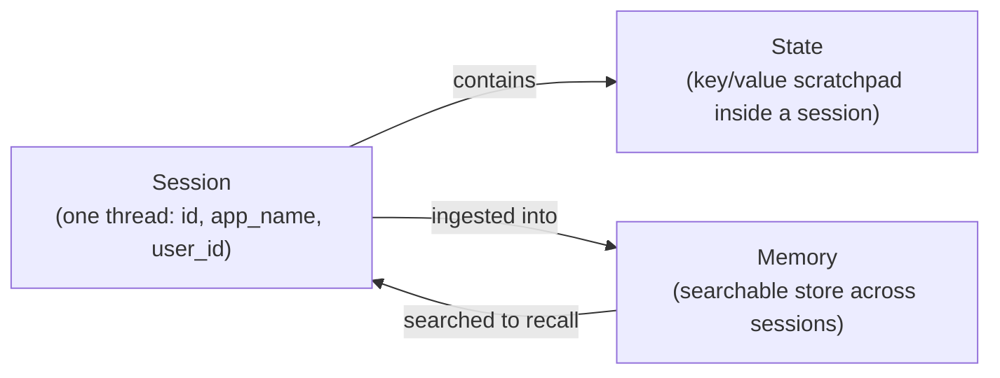
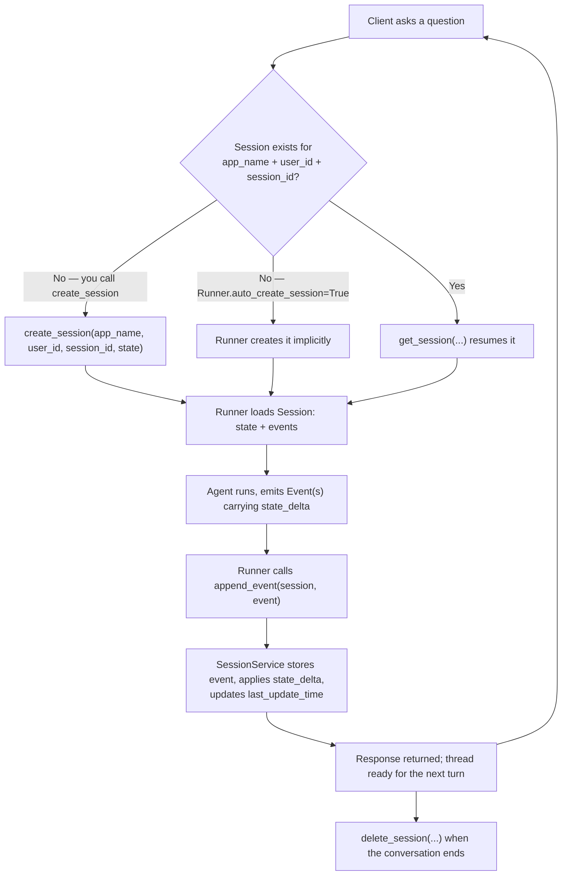
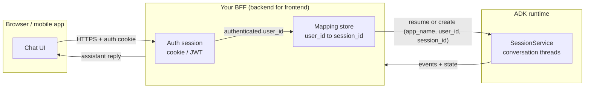
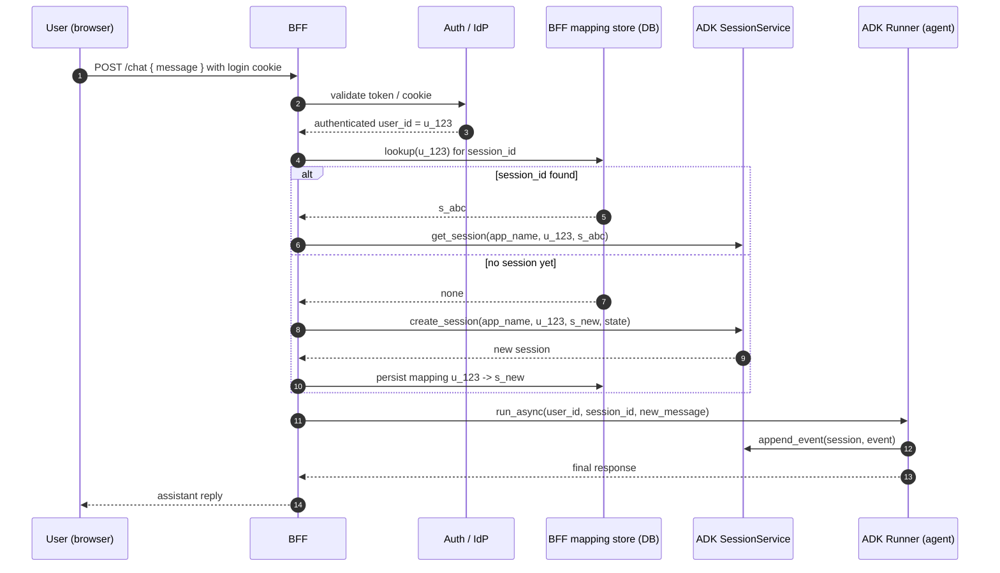
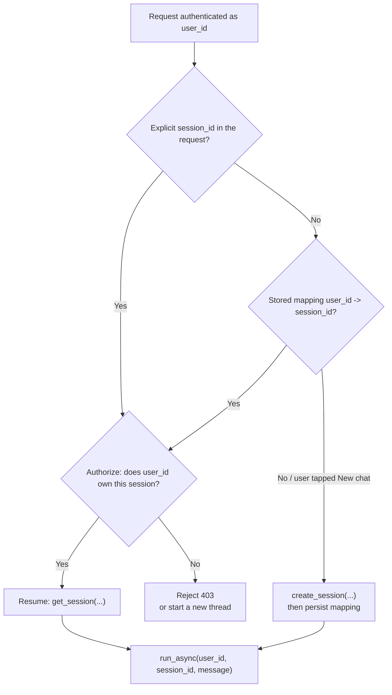
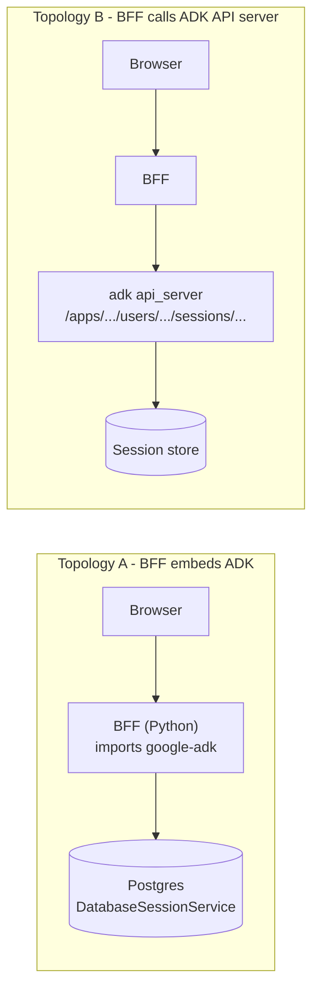
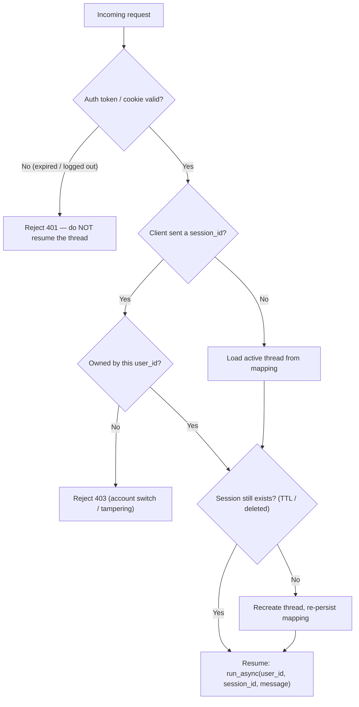

# ADK Sessions & the BFF Pattern — Reusing a Logged-In User's Session

This document explains how sessions work in the Google **Agent Development Kit
(ADK)**, and how to put a **BFF (backend for frontend)** in front of your agent so
that a logged-in user's conversation is created, resumed, and protected
correctly.

It is written to be read top-to-bottom by someone who has never touched ADK
sessions before. Every claim about ADK comes from the official documentation
(links at the bottom).

Companion docs:

- [`ARCHITECTURE.md`](./ARCHITECTURE.md) — the whole system in plain language
- [`AGENT_RUNTIME_A2A.md`](./AGENT_RUNTIME_A2A.md) — how the supervisor reaches other agents

---

## 0. The 30-second version

The single most important idea in this whole document:

> **An ADK session is not your login session.**

Your web login is a cookie or a JWT. ADK has never heard of it and cannot see it.
An ADK `Session` is simply *one conversation thread*, addressed by three strings
**you** supply: `app_name`, `user_id`, and `session_id`.

Because ADK does not know who logged in, it will neither reuse nor invent a
session from your login. **You** decide the mapping:

- **Reuse** a thread → pass an existing `session_id` and ADK resumes it.
- **Start fresh** → create a new thread with a new `session_id`.

A BFF is the natural place to own that decision, because the BFF is already where
your authentication lives.



---

## 1. ADK session fundamentals

### 1.1 What a `Session` is

When a user starts interacting with your agent, the **`SessionService`** creates a
`Session` (`google.adk.sessions.Session`). It is the container for *one specific
chat thread*. Its properties:

| Property | Meaning |
|---|---|
| `id` | Unique identifier for **this** conversation thread. Used to retrieve it later. |
| `app_name` | Which agent application the thread belongs to. |
| `user_id` | Links the thread to a particular user — **a plain label, not an authentication**. |
| `events` | Chronological history of everything that happened: user messages, agent responses, tool calls. |
| `state` | Scratchpad of key/value data relevant **only** to this thread. |
| `last_update_time` | Timestamp of the last event in the thread. |

The three-part key `(app_name, user_id, session_id)` is what you use to find a
thread again. That is the entire identity of a conversation.

### 1.2 Session vs State vs Memory

These are three different scopes of "remembering", and mixing them up is the most
common source of confusion:

| Concept | Lifetime / scope | Managed by | Typical use |
|---|---|---|---|
| **`Session`** | One conversation thread | `SessionService` | The history (`events`) of a single chat |
| **`State`** (`session.state`) | Inside a session, with prefix-controlled reach (see §1.5) | `SessionService` (via `append_event`) | Cart contents, current step, user preferences |
| **`Memory`** | Across many sessions, searchable | `MemoryService` | Long-term knowledge the agent can *search* |

Rule of thumb: **Session & State are "now" — Memory is "everything before".**

### 1.3 The `SessionService` and its implementations

You never create or manage `Session` objects directly. You use a
**`SessionService`**, which owns the lifecycle:

- **Starting** new conversations
- **Resuming** existing ones (by session id)
- **Saving** progress (`append_event`)
- **Listing** a user's threads (`list_sessions`)
- **Cleaning up** (`delete_session`)

ADK ships several implementations. Choosing one is the biggest architectural
decision, because it decides persistence, concurrency, and cost:

| Implementation | Persistent? | Concurrency safety | Best for |
|---|---|---|---|
| `InMemorySessionService` | **No** — lost on restart | **Not** thread-safe | Local dev, tests, examples |
| `DatabaseSessionService` | **Yes** (self-managed DB) | Per-session in-process lock + row-level locking on Postgres/MySQL/MariaDB | Production you control |
| `VertexAiSessionService` | **Yes** (Google Cloud managed) | Managed by the platform | Production on Agent Runtime / Agent Platform |

Two gotchas worth memorising:

- `DatabaseSessionService` needs an **async** driver. For SQLite use
  `sqlite+aiosqlite:///...`, never `sqlite:///...`; for Postgres use `asyncpg`.
- `InMemorySessionService` is fine for a single local process and dangerous for
  anything replicated.

### 1.4 The session lifecycle (one turn)



The important detail is step **H**: state is only persisted as a side-effect of
`append_event`. Writing to `session.state` directly on a session you pulled from
the service is explicitly discouraged — it bypasses event history, usually won't
be saved by `DatabaseSessionService` / `VertexAiSessionService`, and is not
thread-safe.

### 1.5 State scopes (the prefix system)

State keys carry a prefix that decides how far the value reaches:

| Prefix | Scope | Persistence | Example |
|---|---|---|---|
| *(none)* | This session only | Only if the service is persistent | `session.state['booking_step'] = 'confirm_payment'` |
| `user:` | **All sessions for one `user_id`**, within the same `app_name` | Persistent with Database / Vertex | `session.state['user:preferred_language'] = 'fr'` |
| `app:` | All users and sessions for the `app_name` | Persistent with Database / Vertex | `session.state['app:global_discount_code'] = 'SAVE10'` |
| `temp:` | **One invocation only** — discarded when the turn ends | Never | `session.state['temp:raw_api_response'] = {...}` |

There is a useful shortcut for the `user:` scope: `await
session_service.get_user_state(app_name=..., user_id=...)` returns those keys
(with the prefix stripped) **without needing a session**. The exception is
`VertexAiSessionService`, which raises `NotImplementedError` because the managed
API does not expose user state independently of a session — there you enumerate
with `list_sessions(...)` and call `get_session(...)` on each.

Values in state must be **serializable** (strings, numbers, booleans, simple lists
/ dicts). Do **not** store class instances, connections, or secrets there.

### 1.6 How the Runner behaves

- The `Runner` needs a session to exist. If you ask it to run against a missing
  session id, it raises **`SessionNotFoundError`**.
- Construct the Runner with **`auto_create_session=True`** to have it create the
  session implicitly on first use.
- Creating a session that already exists (same `app_name` + `user_id` +
  `session_id`) fails with **`Session already exists`**. So "create" is not
  idempotent — this is exactly why the BFF must track whether a thread already
  exists before calling it.

---

## 2. "Can we reuse the session where the user logged in?"

Short answer: **ADK will not reuse the login session, and it will not create a new
one on its own. You wire the two layers together.**

### 2.1 There are two unrelated sessions



- **Layer 1 — the auth session.** Lifetime = while the user is logged in. Owned by
  your app / IdP. ADK has zero visibility into this.
- **Layer 2 — the ADK session.** Lifetime = the conversation thread. Owned by a
  `SessionService`. It survives (depending on the implementation) far longer than
  a login.

Nothing connects them unless you connect them.

### 2.2 What ADK gives you, and what it does not

**Gives you:**

- Durable, resumable conversation threads keyed by `session_id`.
- Per-user state (`user:` prefix) that spans a user's threads within one app.
- `list_sessions(app_name, user_id)` to find a user's existing threads.

**Does not give you:**

- Any awareness of your login / token.
- Any automatic `user_id` derivation from your auth.
- Any authorization. `user_id` is a **string you supply**; ADK will happily let a
  request with a different `user_id` read a thread if you pass it the id.
- Any persistence of the "which session is this user currently in" decision — that
  mapping is yours to keep.

That last point is the crux: **reuse is a decision your BFF makes, not a feature
ADK turns on.**

---

## 3. The BFF architecture

### 3.1 Responsibility split

| Concern | Owner | Notes |
|---|---|---|
| Login, token/cookie validation | **BFF** | Your IdP / auth middleware |
| Deriving a stable `user_id` | **BFF** | e.g. your internal user PK or a UUID |
| Mapping `user_id → current session_id` | **BFF** | Persisted in *your* DB |
| Authorization (does this user own this thread?) | **BFF** | Mandatory — ADK won't check |
| Seeding identity into `state` | **BFF** | At `create_session`, or via an appended event |
| Conversation history, `state`, `last_update_time` | **ADK** | Never try to re-implement this |
| Choosing the storage backend | **BFF / infra** | In-memory vs DB vs Managed |

The mental model: **the BFF owns "who", ADK owns "what was said".**

### 3.2 Request flow



### 3.3 Create-or-resume decision

This is the branch the BFF exists to make. Make it explicit, and make the
authorization check non-optional.



### 3.4 Deployment topologies

There are two common ways to wire the BFF to ADK. Both are valid; pick by how much
control you want over the agent process.



- **Topology A — BFF embeds the ADK library.** The BFF process imports
  `google-adk`, builds the `Runner`, and picks a `SessionService`. Fewest moving
  parts; the BFF is the agent server. Requires the BFF to be a Python service
  (or Java/Go/TS — ADK is polyglot).
- **Topology B — BFF talks to a separate `adk api_server`.** The agent runs as
  its own service; the BFF is a thin client. The BFF passes
  `appName` / `userId` / `sessionId` in the request body. Best when the agent has
  its own release cadence or scaling profile.
- **Topology C — managed.** Deploy the agent to **Agent Runtime** and use
  `VertexAiSessionService`; the BFF still carries `userId` + `sessionId`. This is
  the only option that gives you session **TTL** out of the box.

---

## 4. Implementation guide

### 4.1 Data model

Your BFF needs one extra table: the user → thread mapping. Keep the ADK-managed
session store separate from your application database.

```sql
-- Your application database (BFF-owned)
CREATE TABLE chat_threads (
    user_id     TEXT      NOT NULL,          -- your authenticated user identity
    session_id  TEXT      NOT NULL,          -- the ADK session id
    title       TEXT,                        -- optional, for a thread list in the UI
    created_at  TIMESTAMPTZ NOT NULL DEFAULT now(),
    last_seen_at TIMESTAMPTZ NOT NULL DEFAULT now(),
    PRIMARY KEY (user_id, session_id)
);

-- Optional: exactly one "active" thread per user
CREATE UNIQUE INDEX one_active_thread_per_user
    ON chat_threads (user_id)
    WHERE is_active;          -- add an is_active boolean if you want this model
```

The ADK session store (Postgres via `DatabaseSessionService`, or Agent Platform)
holds `events` and `state`. Your table holds the *pointer*.

### 4.2 A minimal FastAPI BFF (Topology A)

Pseudo-code, but structured exactly like the real thing. The two ADK entry points
used are `create_session` / `get_session` and `runner.run_async(...)`.

```python
import os
import uuid

from fastapi import FastAPI, Depends, HTTPException
from pydantic import BaseModel

from google.adk.runners import Runner
from google.adk.sessions import DatabaseSessionService
from google.genai import types

# --- ADK wiring (do this once per process) -------------------------------
APP_NAME = "my_chatbot"
session_service = DatabaseSessionService(
    db_url=os.environ["SESSION_DB_URL"],   # e.g. postgresql+asyncpg://...
)

runner = Runner(
    agent=my_agent,
    app_name=APP_NAME,
    session_service=session_service,
    auto_create_session=False,             # the BFF decides creation explicitly
)


# --- Mapping store (your application DB) ---------------------------------
def lookup_user_session(user_id: str) -> str | None:
    """Return the ADK session_id for this user, or None."""
    ...

def persist_user_session(user_id: str, session_id: str, title: str | None = None) -> None:
    ...


# --- Request model --------------------------------------------------------
class ChatRequest(BaseModel):
    message: str
    session_id: str | None = None          # omit to continue the active thread


app = FastAPI()


@app.post("/chat")
async def chat(req: ChatRequest, user_id: str = Depends(current_user)):
    # 1. Resolve which thread this turn belongs to ---------------------------
    session_id = req.session_id
    if session_id is not None:
        # Explicit thread requested: authorize before touching it.
        owned = lookup_user_session(user_id)
        if owned != session_id:
            raise HTTPException(status_code=403, detail="Not your session")
    else:
        session_id = lookup_user_session(user_id)

    # 2. Create a thread if there is none ------------------------------------
    if session_id is None:
        session_id = f"s-{uuid.uuid4().hex[:12]}"
        await session_service.create_session(
            app_name=APP_NAME,
            user_id=user_id,
            session_id=session_id,
            # Seed identity so the agent knows who it is talking to.
            state={"user:display_name": await display_name_for(user_id)},
        )
        persist_user_session(user_id, session_id)

    # 3. Run a turn ----------------------------------------------------------
    content = types.Content(role="user", parts=[types.Part(text=req.message)])
    final_text = None
    async for event in runner.run_async(
        user_id=user_id,
        session_id=session_id,
        new_message=content,
    ):
        if event.is_final_response() and event.content:
            final_text = event.content.parts[0].text

    return {"session_id": session_id, "reply": final_text}
```

Points that matter:

- **`current_user`** is ordinary auth middleware — the ADK layer is downstream of
  it and must never be trusted on its own.
- **`lookup_user_session` is the reuse switch.** Return a value → resume. Return
  `None` → create.
- **Authorization before `get_session`.** ADK will not stop user A from reading
  user B's thread if the ids line up in the request.
- **Seed `user:` state at creation.** Because `user:` keys span every session for
  that `user_id`, the agent keeps the user's identity/preferences even when the
  user starts a brand-new thread.

### 4.3 The same flow against `adk api_server` (Topology B)

If the agent runs as its own service, the BFF does not import ADK. It just forwards
the identity and the thread id. The REST surface is keyed on all three parts:

```
# Create a thread
POST /apps/{app_name}/users/{user_id}/sessions/{session_id}
     body (optional): the initial state dict

# Resume + run
POST /run            (single response)
POST /run_sse        (streamed; add "streaming": true for token-level chunks)

# Inspect / clean up
GET    /apps/{app_name}/users/{user_id}/sessions/{session_id}
DELETE /apps/{app_name}/users/{user_id}/sessions/{session_id}
```

A `/run` body:

```json
{
  "appName": "my_chatbot",
  "userId": "u_123",
  "sessionId": "s-abc123",
  "newMessage": { "role": "user", "parts": [{ "text": "Hello" }] }
}
```

The BFF's job is unchanged — authenticate, resolve `session_id`, then call
`/run` (creating the session first if needed). It just speaks HTTP instead of
importing the library.

> Note: in TypeScript, only `camelCase` field names are accepted (`appName`,
> `userId`, `sessionId`, ...).

### 4.4 Reading identity before a session exists

If your UI wants to show something personalised before the first message, you can
read `user:` state without a session — except on Vertex:

```python
state = await session_service.get_user_state(app_name=APP_NAME, user_id=user_id)
```

On `VertexAiSessionService` this raises `NotImplementedError`; instead call
`list_sessions(app_name=APP_NAME, user_id=user_id)` and then `get_session(...)`
on the results to recover the same values.

---

## 5. Production considerations

### 5.1 Picking a SessionService

| | In-memory | Database | Vertex / Agent Platform |
|---|---|---|---|
| Survives restart | No | Yes | Yes |
| Works across replicas | No | Yes (with row locking) | Yes |
| You manage the DB | — | Yes | No |
| Session TTL | No | Not guaranteed | **Yes** (default 365 days) |
| Good for | Dev / tests | Self-hosted prod | Managed prod |

Rule of thumb: **single local process → in-memory; anything replicated → Database
or Vertex.**

### 5.2 Concurrency

Two requests for the same thread can race. What protects you:

- `DatabaseSessionService` serialises `append_event` for a session with an
  **in-process lock**, and uses **row-level locking** (`SELECT ... FOR UPDATE`) on
  Postgres / MySQL / MariaDB so multiple processes are safe too.
- `InMemorySessionService` is **not** safe for multi-threaded use.

If your BFF is horizontally scaled, you need the Database or Vertex backend —
otherwise two replicas hold two different copies of the conversation.

### 5.3 Time to live

- Only `VertexAiSessionService` supports session expiration. If neither `ttl` nor
  `expire_time` is set, the platform default is **365 days**.
- Other session services may not support TTL, so if you need automatic cleanup,
  schedule your own job that calls `delete_session(...)`.
- Deleting a session also deletes its child events.

### 5.4 Custom session ids

If you generate your own `session_id` (rather than letting the service do it),
respect the platform's rules to avoid collisions:

- First character a letter → up to **63 chars**, valid set `[a-z0-9-]`, last char
  alphanumeric.
- First character a number → up to **9 digits**, no leading zeros.

A prefixed UUID (`s-<hex>`) satisfies the letter rule comfortably.

### 5.5 Security checklist

- **Authorize every resume.** Establish that the authenticated `user_id` owns the
  requested `session_id` before calling `get_session` or `run`. ADK's `user_id` is
  a label, not a guard.
- **Never trust an inbound `session_id`** from the client without the ownership
  check.
- **Do not store secrets in `state`.** It must be serializable, and it is readable
  wherever your session store lives. Keep tokens in the BFF/vault and put only
  identifiers in state.
- **Namespace tenants with `app_name`** (or a separate deployment per tenant) if
  you need hard isolation between organisations.
- **Treat `user_id` as PII.** Derive it from your internal identity, not from an
  email address, and keep it stable across logins so `user:` state survives.

---

## 6. Common pitfalls

| Symptom | Cause | Fix |
|---|---|---|
| `SessionNotFoundError` | Running against a `session_id` that was never created | Create it first, or set `auto_create_session=True` |
| `Session already exists` | Calling `create_session` for an existing `(app_name, user_id, session_id)` | Look up the mapping and `get_session` instead |
| Conversation resets on every deploy | Using `InMemorySessionService` | Switch to `DatabaseSessionService` / Vertex |
| Different answers from different replicas | In-memory service behind a load balancer | Use the Database/Vertex backend (shared, locked) |
| User A sees User B's history | No ownership check before resume | Authorize `user_id` vs `session_id` in the BFF |
| State changes vanish | Writing to `session.state` directly on a retrieved session | Update via context/`state_delta` so `append_event` persists it |
| `await` outside function error | ADK is async-first; running snippets as scripts | Wrap in `asyncio.run(...)` |
| SQLite driver error | Synchronous driver string | Use `sqlite+aiosqlite:///...` |

---

## 7. Situations & failure modes

The happy path — authenticate, resolve a thread, run — is only one of many paths.
This section catalogues the situations that actually come up in production,
grouped by where they bite. Each entry says what happens and what the BFF should
do.

### 7.1 Identity & auth boundary cases

These are about the seam between your login and ADK — the seam most likely to be
wrong.

- **Web session and ADK session lifetimes diverge.** A short-lived JWT can expire
  while the ADK thread keeps living (or the reverse). Decide explicitly what a
  request with an expired token but a valid `session_id` does; the safe answer is
  reject with `401` and **never** resume the thread.
- **Second device / multiple tabs.** The same `user_id` + `session_id` is one
  shared thread across devices. That is continuity if you want it, and a bug if you
  wanted one thread per device. The mapping table encodes the choice.
- **Account switch in the same browser.** A stale client-side `session_id` from
  user A plus a fresh login as user B must fail the ownership check — not silently
  resume A's history.
- **Anonymous → authenticated upgrade.** Guest chats that happened before login
  cannot be merged by re-keying an existing session's `user_id`. Create a fresh
  thread for the logged-in user and copy over any `user:` state you care about.
- **Logout semantics.** Logging out clears the cookie; it does **not** delete the
  ADK session or its event history. If logout should erase the thread, call
  `delete_session(...)` yourself.
- **The agent's own third-party auth.** Distinct from your app login. ADK events
  carry `requestedAuthConfigs`, so the agent can ask the end user for credentials
  (e.g. OAuth to an external service) mid-conversation. Being logged in to your app
  does **not** authorize that — it is a separate consent flow.



### 7.2 Concurrency & reliability

- **Double-send / same user in two tabs.** Two in-flight turns on one session
  interleave events, and state updates become last-write-wins. Serialise with a
  per-session queue (or a distributed lock) and queue or reject the second turn.
- **Retries and idempotency.** A timeout followed by a client retry appends the
  same message twice — ADK does not dedupe. Carry a client-supplied message/turn id
  and drop duplicates before calling `run_async`.
- **`auto_create_session` race.** Two concurrent first messages can both try to
  create the same session; the loser gets `Session already exists`. Catch it and
  fall back to `get_session(...)`.
- **Crash or resume mid-run.** A run can die after some events are already
  appended. Use ADK's documented resume semantics rather than assuming the turn
  either fully happened or did not (see *Resume Agents* in the runtime reference).
- **Streaming disconnect / cancellation.** On `/run_sse`, a client that drops
  mid-stream leaves partial events in the history, and token-level streaming
  changes what "the turn" means. Decide whether a disconnected turn is kept,
  trimmed, or completed server-side. (Cancellation is documented for TypeScript via
  `AbortSignal`.)
- **Long-running / human-in-the-loop tools.** A tool that takes minutes makes a
  turn that spans several HTTP requests, with a pending state you must persist and
  poll for. ADK signals these with `longRunningToolIds` on the event.

### 7.3 Lifecycle & growth

- **TTL expiry mid-conversation** (Vertex only): the session can be deleted under
  you, so the next request raises `SessionNotFoundError`. Detect it and
  transparently recreate the thread (and re-seed `user:` state).
- **Unbounded history.** Long threads grow `events` forever, inflating cost and
  latency and eventually overflowing the context window. Real systems compact,
  summarise, or roll over to a fresh session.
- **Many threads per user.** A ChatGPT-style sidebar needs `list_sessions(...)`
  plus your own titles, so the mapping is no longer a single row per user.
- **Artifacts vs state.** Uploaded files and large blobs belong in ADK's artifact
  surface (events carry `artifactDelta`), not in `state`. Keep `state` small and
  serializable; put large payloads in your own object storage or as artifacts.
- **State size limits.** Because `state` must be serializable and is persisted by
  the service, oversized values can be rejected or truncated. Keep it minimal.

### 7.4 Operations

- **`app_name` drift.** Different `app_name` values are different namespaces, so a
  typo — or a local vs deployed name, or the Vertex reasoning-engine name —
  silently forks the session store. Treat `app_name` as a constant, ideally
  config-driven.
- **Scaling topology.** In-memory needs sticky routing; DB / Vertex do not. Mixing
  the two across replicas produces split-brain conversations.
- **DB schema migrations.** The session database schema changed in ADK Python
  v1.22.0 and requires migration on upgrade — plan it like any schema change.
- **Quotas & rate limits.** Managed session stores enforce quotas; treat store
  errors as first-class (back off, surface, do not retry blindly).
- **Data residency.** Managed sessions live in a chosen region; check the
  compliance implications of where conversation history is stored.
- **Orphaned sessions & erasure.** Offboarded or deleted users leave threads
  behind. A GDPR-style "delete my data" request must reach `events` (which hold
  PII), not just your mapping table.

---

## 8. Quick reference

**SessionService methods**

```text
create_session(app_name, user_id, session_id=None, state={...})
get_session(app_name, user_id, session_id)
append_event(session, event)          # usually called by the Runner
list_sessions(app_name, user_id)
delete_session(app_name, user_id, session_id)
get_user_state(app_name, user_id)     # user: keys only; Vertex raises NotImplementedError
```

**State prefixes**

```text
(no prefix)   this session only
user:         all sessions for this user_id within this app_name
app:          all users and sessions for this app_name
temp:         this invocation only (never persisted)
```

**The BFF contract, in one line each**

- Authenticate the request → stable `user_id`.
- Resolve `session_id` from the mapping store (or an explicit, authorized id).
- Create + persist if absent; resume if present.
- `run_async(user_id, session_id, message)` and stream the reply back.
- Never let the client's `session_id` bypass the ownership check.

---

## References (official documentation)

- [Session: Tracking individual conversations](https://adk.dev/sessions/session/)
- [Conversational context: Session, State, and Memory](https://adk.dev/sessions/)
- [State: The Session's Scratchpad](https://adk.dev/sessions/state/)
- [Agent Runtime](https://adk.dev/runtime/)
- [Use the API Server](https://adk.dev/runtime/api-server/)
- [Manage sessions with Agent Development Kit (Google Cloud)](https://docs.cloud.google.com/gemini-enterprise-agent-platform/scale/sessions/manage-with-adk)
