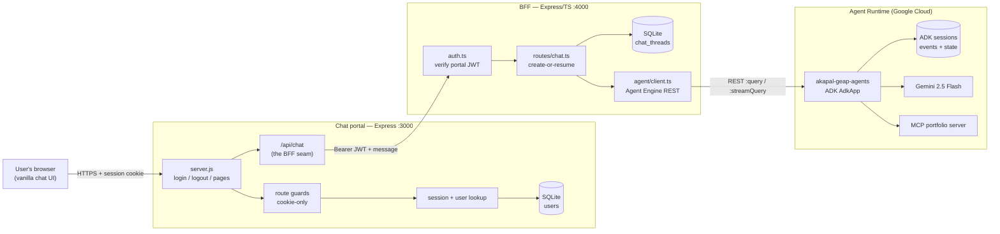
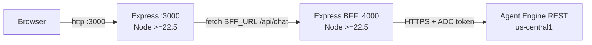
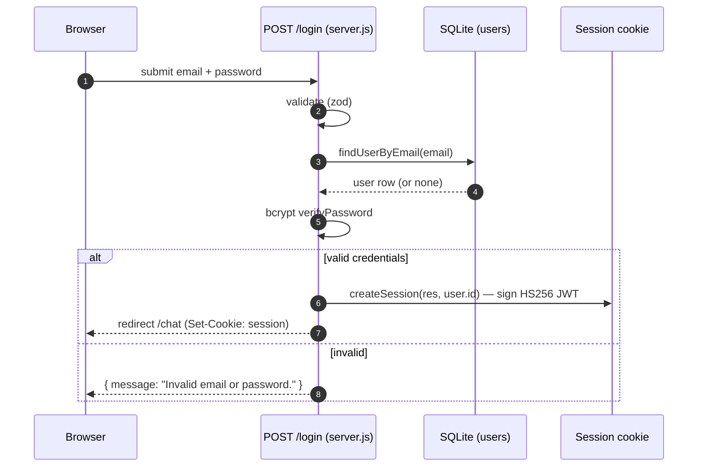
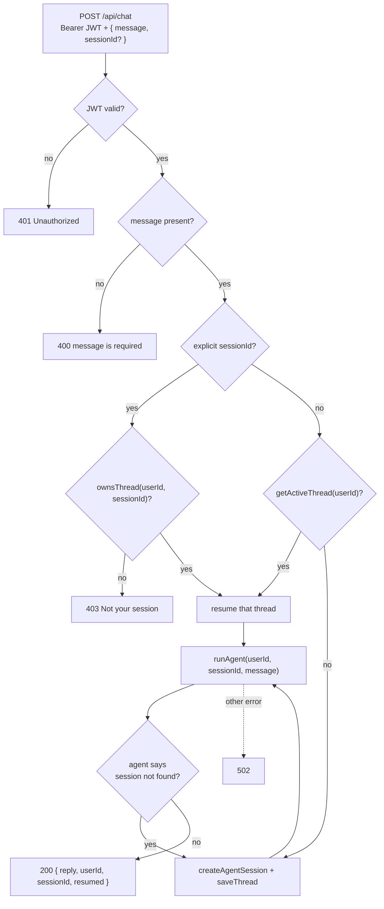
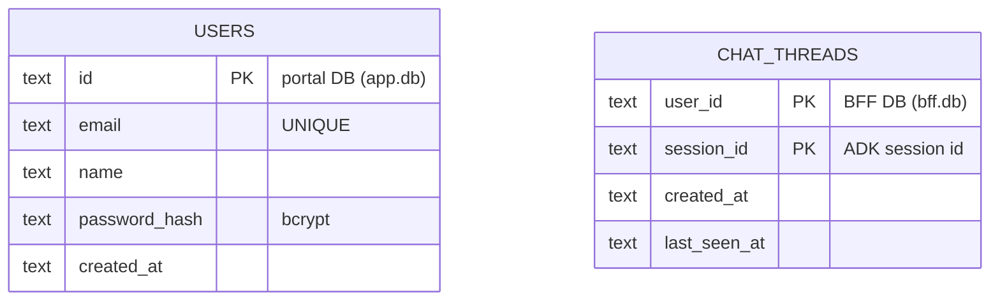
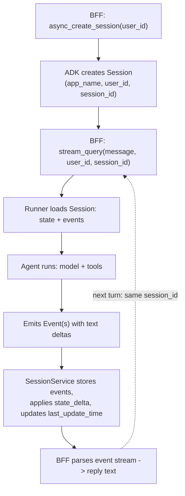
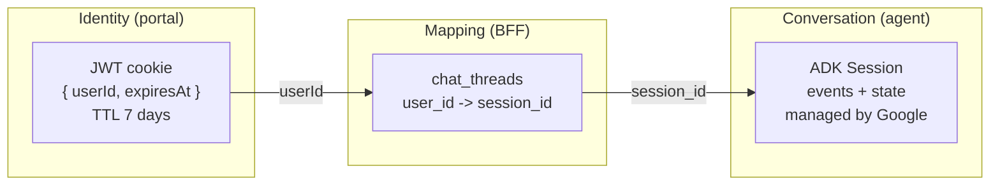
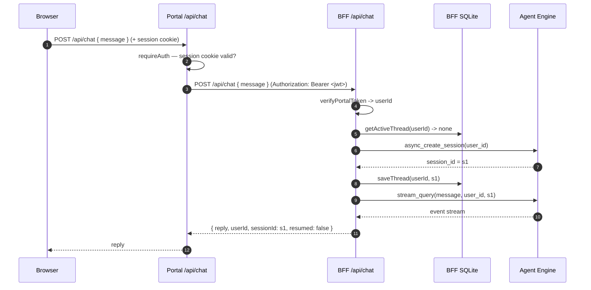
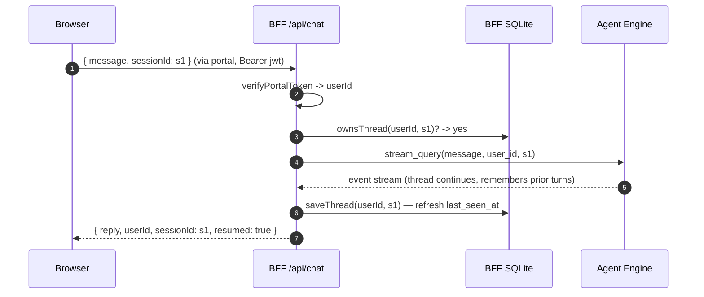

# Architecture — akapal-geap chat system

This document describes the full system end to end: the **chat portal** (Express),
the **BFF** (Express/TypeScript), and the **agent** (Google ADK on Agent Runtime /
Agent Engine), plus the two SQLite stores and the contracts between them.

Read it top to bottom:

1. [Overview](#1-overview) — the whole thing on one page.
2. [Component map](#2-component-map) — who does what.
3. [Deep dive](#3-deep-dive) — one section per component, step by step.
4. [End-to-end walkthrough](#4-end-to-end-walkthrough) — a first turn and a resumed turn.
5. [Contracts](#5-contracts) — HTTP surfaces, payloads, env vars, databases.
6. [Failure modes & design decisions](#6-failure-modes--design-decisions)
7. [Local development](#7-local-development)

Every diagram is followed by a **Reading this diagram** note that explains the
shapes, arrows and labels, so the diagram stands on its own.

---

## 1. Overview

Three tiers, each with a clear owner, connected by two well-defined seams:

- **Chat portal** — the browser-facing Express app (a single `server.js`; no
  framework on the front end and no build step). It owns *login* and *who the
  user is*. It serves the chat UI and exposes a single server route,
  `/api/chat`, that acts as the seam to the BFF.
- **BFF** (backend-for-frontend) — an Express service that owns the *mapping
  between a logged-in user and an agent conversation*, and the authorization
  that goes with it. It is the only place that knows both sides.
- **Agent** — an ADK agent deployed as a Reasoning Engine on Agent Runtime. It
  owns *what was said*: the conversation history, memory and state. It knows
  nothing about logins.

### The one idea the whole design hangs on

> **A login session is not an agent session.**

The portal's session is a JWT cookie that proves who the user is. The agent's
session is a *conversation thread* addressed by `(app_name, user_id, session_id)`.
Google's ADK does not read your cookie, cannot see your login, and will not
reuse or invent a thread from it. Someone has to decide "does this user already
have a conversation, or do we start a new one?" — and hold a stable identity to
key it on.

That someone is the BFF. This is the single responsibility that justifies its
existence; everything else in the BFF exists to support it.

### System context



**Reading this diagram.** Boxes are running pieces of software; the rounded
`[( ... )]` shapes are data stores. Left-to-right follows the direction of a user
request. The three `subgraph` boxes are the three trust/deployment boundaries:
browser + portal, the BFF service, and Google Cloud. Arrow labels are the wire
format on that hop. Note the two separate databases — the portal's `users` table
and the BFF's `chat_threads` table — which is the physical expression of the
"two sessions" idea: identity lives on the left, conversation mapping lives in
the middle. The agent on the far right touches a model and an MCP tool server,
but never the portal or the BFF's database.

### Deployment / runtime view



**Reading this diagram.** This is the same system as above stripped to
*processes and ports*. Two independent Node processes run locally: the portal on
`:3000` and the BFF on `:4000`, wired by the `BFF_URL` env var. Only the BFF
talks to Google. The browser never contacts the BFF directly — every call goes
through the portal's `/api/chat`, which is what keeps the portal's session cookie
the single source of identity.

---

## 2. Component map

| Component | Tech | Owns | Key files | State |
|---|---|---|---|---|
| Chat portal | Express 4 (single `server.js`), vanilla JS, no build step, Node ≥22.5 | Login, session cookie, UI, BFF seam | `server.js`, `public/**` | `data/app.db` (`users`) |
| BFF | Express 4, TypeScript (ESM), Node ≥22.5 | User↔session mapping, authorization, agent calls | `src/auth.ts`, `src/store.ts`, `src/routes/chat.ts`, `src/agent/*` | `data/bff.db` (`chat_threads`) |
| Agent | Google ADK 2.6.2 (`AdkApp`) on Agent Runtime | Conversation history, memory, state, model calls | deployed from `akapal-geap-agent` (`deploy_adk.py`, `app/agent.py`) | Agent Engine sessions |
| Identity | JWT (HS256 via `jose`), httpOnly cookie | — | `server.js` (portal), `src/auth.ts` (BFF) | — |
| Model / tools | Gemini 2.5 Flash, MCP portfolio server, A2A financial planner | — | agent deployment env | — |

---

## 3. Deep dive

Each subsection below follows the same shape: **what it is → what it does, step
by step → the diagram → how to read the diagram**.

### 3.1 Chat portal (Express)

**What it is.** A single `server.js` — an Express 4 app with no front-end
framework and no build step. It serves the login page, the chat page, and one API
route, and holds the user's credentials and their session. The database, JWT,
password hashing and zod all live in this one file; the UI is static HTML/CSS/JS
under `public/`.

**What it does, step by step.**

1. **Login.** `public/login.html` + `public/js/login.js` POST JSON to `POST /login`
   on the server. `server.js` validates input with a zod schema
   (`LoginFormSchema`), looks the user up by email (node:sqlite `users` table),
   verifies the password (`bcryptjs`, 10 rounds), and — on success — calls
   `createSession(res, user.id)`.
2. **Session.** `signSession` signs a JWT with payload `{ userId, expiresAt }`
   using HS256 and `SESSION_SECRET`; `createSession` stores it via `res.cookie` as
   an **httpOnly, `sameSite=lax` cookie** named `session`, with a 7-day TTL. The
   `Secure` flag is driven by a dedicated `COOKIE_SECURE` env var (not
   `NODE_ENV`) so it works over plain http on localhost.
3. **Route guards.** `requireAuth` / `redirectIfAuthed` in `server.js` run on
   `GET /chat` and `GET /login`. They verify the cookie and redirect:
   unauthenticated `/chat` → `/login`, authenticated `/login` → `/chat`. This is
   a *fast, cookie-only* check — no database access.
4. **Secure check.** The chat page is only served after `requireAuth` has verified
   the session, and the API routes assert it again. The API uses
   `requireAuthJson`, which returns `401` instead of redirecting. There is no
   separate DAL module — the identity check is `verifySession(req)` →
   `payload.userId`.
5. **Chat UI.** `public/chat.html` + `public/js/chat.js` render the message list
   and stream a reply. On load, `chat.js` fetches `/api/me` to fill in the user's
   name, keeps the message list locally, POSTs to `/api/chat`, and shows the
   current agent thread id.
6. **The seam.** `POST /api/chat` in `server.js` is the critical boundary. It:
   confirms the user (401 otherwise), reads the raw session JWT, and forwards
   `{ message, sessionId }` to `${BFF_URL}/api/chat` with
   `Authorization: Bearer <jwt>`. It relays the BFF's `text/event-stream` straight
   through (or `502 BFF unreachable` if the BFF is down).



**Reading this diagram.** A `sequenceDiagram` reads top-to-bottom as time, with
each vertical lifeline being a participant. `->>` is a call, `-->>` is a
response, and the `alt/else/end` block is a branch — only one arm executes.
Step 3/4 show that credential checking never leaves the server. The key output is
the last line of the happy path: the user is redirected and a cookie is set; from
then on, every request carries that cookie, and nothing else about the user is
re-derived.

### 3.2 BFF (Express / TypeScript)

**What it is.** A small Express service whose *reason to exist* is the mapping in
`src/store.ts` and the decision in `src/routes/chat.ts`. Around that sit a JWT
verifier and an Agent Engine client.

**What it does, step by step.**

1. **Authenticate.** `src/auth.ts` verifies the incoming
   `Authorization: Bearer <jwt>` with the *same* `SESSION_SECRET` the portal uses
   (`jose`, HS256) and sets `req.userId`. This is deliberately thin: the BFF does
   not implement login, it consumes the portal's already-established identity.
   No token → `401`.
2. **Resolve the thread.** `POST /api/chat` (`src/routes/chat.ts`) decides which
   agent conversation this turn belongs to:
   - If the client sent an explicit `sessionId`, the BFF **authorizes it** with
     `ownsThread(userId, sessionId)`. Not owned → `403`. This check is mandatory:
     ADK's `user_id` is a label, not a guard, so without it user A could read
     user B's thread.
   - Otherwise it loads the user's active thread with `getActiveThread(userId)`.
3. **Create or resume.** If no thread was resolved, the BFF asks the agent to
   create one (`createAgentSession`) and persists the mapping (`saveThread`).
   Otherwise it resumes the existing thread.
4. **Run the turn.** `runAgent(userId, sessionId, message)` calls the agent and
   returns the reply text.
5. **Handle a dead session.** If the agent reports the session is gone
   (stale/evicted), the BFF recreates the session, re-persists the new mapping,
   and retries **once**.
6. **Respond.** `{ reply, userId, sessionId, resumed }`, where `resumed=false`
   means a new agent session was created for this turn. Upstream failures become
   `502`.



**Reading this diagram.** A `flowchart TD` reads top-down as *control flow*;
diamonds are decisions, rectangles are actions, and each labeled edge is the
answer to the decision above it. Follow any path from the top node and you get a
complete request lifecycle — for example the authorization path
`S → O → O1` is "client sent a thread id it doesn't own → reject with 403". The
arrow from `DEAD` back up to `NEW` is the single retry: note it loops to *create*
a fresh session, which is exactly what makes an evicted session self-heal. The
dotted edge marks the non-retryable error escape hatch.

**The mapping store.** `src/store.ts` is a SQLite database (`node:sqlite`, zero
dependencies) holding one table:



**Reading this diagram.** An `erDiagram` lists tables as boxes and their columns
with types; `PK` marks a primary key. Here the two boxes deliberately live in
**different databases** (annotated in the description strings) and there is **no
foreign key between them** — the only link is that `CHAT_THREADS.user_id` equals
`USERS.id`. The composite primary key `(user_id, session_id)` is what makes a
thread unique per user and lets the store upsert safely on re-deploy. "Active
thread" is simply the row with the newest `last_seen_at` for that user.

**The agent client.** `src/agent/client.ts` authenticates to Google with
Application Default Credentials (no keys in the repo), then calls two REST
methods on the Reasoning Engine:
`POST …:query` with `class_method: "async_create_session"` to create a session,
and `POST …:streamQuery` with `class_method: "stream_query"` to run a turn.
`src/agent/stream.ts` parses the response, which is *not* a single JSON document
but a **stream of concatenated JSON events** — the parser tracks brace depth and
string escaping across chunks to split them, then `extractText` keeps only
settled, non-user text. The whole stream is currently buffered into one reply
(marked `ponytail:` in the code) rather than relayed as SSE.

### 3.3 Agent (Google ADK on Agent Runtime)

**What it is.** The `akapal-geap-agents` Reasoning Engine in project
`adk-tut-508714`, region `us-central1` (id `335803495506509824`). It is an
`AdkApp` — Google's wrapper that turns an ADK agent into a managed service with
no FastAPI/uvicorn/Docker to own.

**What it does, step by step.**

1. The BFF calls `:query` with `class_method: "async_create_session"` and
   `input.user_id`. The agent creates a session and returns its id.
2. The BFF calls `:streamQuery` with `class_method: "stream_query"` and
   `input: { message, user_id, session_id, run_config: { streaming_mode: "sse" } }`.
   The `streaming_mode: "sse"` is important: without it ADK defaults to
   `StreamingMode.NONE` and emits one final event with no partials.
3. The agent loads the thread's `events` and `state`, runs the agent (Gemini 2.5
   Flash, plus MCP portfolio tools), and streams events back.
4. The agent persists progress by appending events to its session store. State is
   only saved as a side-effect of appending — writing `session.state` directly is
   discouraged.



**Reading this diagram.** Another top-down control flow, but this one is the
*agent's own* lifecycle. The loop-back edge (dotted) from `H` to `C` is the point:
every subsequent turn re-enters at `stream_query` with the **same** `session_id`,
which is what makes the conversation continuous. `G` is where the agent, not the
BFF, owns persistence — the BFF never stores conversation text, only the pointer
to it. This is the concrete meaning of "ADK owns what was said."

### 3.4 Where the two sessions live



**Reading this diagram.** Three boxes, one per store, left to right in
increasing lifetime. The arrows are the *only* links: the cookie's `userId`
becomes the mapping's key, and the mapping's `session_id` becomes the agent's
handle. Because the middle arrow is a stored row rather than something the
agent remembers, a user can log out and back in — a new cookie — and still
resume the same conversation, which is the whole point.

---

## 4. End-to-end walkthrough

### 4.1 First message from a fresh user



**Reading this diagram.** Time flows down; each column is a process. The
`alt`-style branch is implied by the results: `getActiveThread` returns *none*,
so the create arm runs. The BFF is the only participant that talks to both the
database and the agent — it is the pivot of the whole diagram. The portal appears
twice on purpose: once doing its own auth, once forwarding.

### 4.2 Second message (resume)



**Reading this diagram.** Same skeleton as the first turn, but two differences
carry all the meaning: the client now sends `sessionId: s1`, so the BFF takes the
**explicit-resume** path and runs `ownsThread` (the authorization check) instead
of creating; and the agent is handed the *same* `session_id`, so the thread
continues and the model remembers earlier turns. `resumed: true` reports which
path ran.

---

## 5. Contracts

### 5.1 HTTP

| Hop | Method + path | Auth | Body | Response |
|---|---|---|---|---|
| Browser → portal | `POST /api/chat` | session cookie | `{ message, sessionId? }` | `{ reply, userId, sessionId, resumed }` |
| Portal → BFF | `POST /api/chat` | `Authorization: Bearer <jwt>` | `{ message, sessionId? }` | same shape |
| BFF → portal (errors) | — | — | — | `400 / 401 / 403 / 502 { error }` |
| BFF → agent | `POST …:query` | ADC bearer token | `{ class_method: "async_create_session", input: { user_id } }` | `{ output: { id } }` |
| BFF → agent | `POST …:streamQuery` | ADC bearer token | `{ class_method: "stream_query", input: { message, user_id, session_id, run_config } }` | concatenated JSON events |

`resumed` semantics: `false` = the BFF created a new agent session this turn;
`true` = it reused an existing one.

### 5.2 Environment

**Portal** (`.env`)

| Var | Meaning |
|---|---|
| `SESSION_SECRET` | HS256 key for the session JWT (shared with the BFF) |
| `DATABASE_PATH` | SQLite path, default `./data/app.db` |
| `COOKIE_SECURE` | `true` only behind HTTPS |
| `BFF_URL` | Base URL of the BFF, default `http://localhost:4000` |
| `PORT` | listen port, default `3000` |

**BFF** (`.env`)

| Var | Meaning |
|---|---|
| `PORT` | listen port, default `4000` |
| `SESSION_SECRET` | must equal the portal's, to verify its JWT |
| `DATABASE_PATH` | mapping DB, default `./data/bff.db` |
| `GEAP_ENGINE_PROJECT` | `adk-tut-508714` |
| `GEAP_ENGINE_LOCATION` | `us-central1` |
| `GEAP_ENGINE_ID` | `335803495506509824` |

The two services are coupled by exactly one shared value — `SESSION_SECRET` — and
one URL, `BFF_URL`. Everything else is independent.

### 5.3 Databases

| Store | Owner | Table | Purpose |
|---|---|---|---|
| `data/app.db` | portal | `users(id, email, name, password_hash, created_at)` | credentials |
| `data/bff.db` | BFF | `chat_threads(user_id, session_id, created_at, last_seen_at)` | user↔session mapping |
| Agent Engine | Google | ADK sessions (`events`, `state`) | conversation content |

---

## 6. Failure modes & design decisions

| Situation | Behaviour | Why |
|---|---|---|
| No/invalid session cookie at the portal | Portal `/api/chat` → `401` | identity is established before anything else |
| Invalid/expired JWT at the BFF | `401` | the BFF never trusts an unverified caller |
| Client sends a `sessionId` it doesn't own | `403 Not your session` | ADK does not enforce ownership; the BFF must |
| Agent session evicted/expired | BFF recreates once, re-persists, retries | a dead thread should self-heal, not 500 |
| BFF down | Portal → `502 BFF unreachable` | fail loudly at the seam, don't hang |
| Agent/IAM error | BFF → `502` with upstream detail | surfaces the real cause during bring-up (leaks detail — sanitize for production) |
| Logout | Clears the cookie only; the agent thread survives | logging out ends the login, not the conversation |
| Horizontal scaling | Would need a shared DB and a real session store | in-memory mapping is per-process |

Design decisions worth naming:

- **Stateless JWT, not a session table**, for the portal — no server-side session
  store to run.
- **`node:sqlite`** in both services — zero external database to operate.
- **The BFF holds the mapping, not the portal** — so identity and conversation can
  evolve independently, and the agent never needs to know about logins.
- **Buffered agent replies** (no SSE yet) — simplest correct thing; the seam is
  ready for streaming when time-to-first-token matters.

---

## 7. Local development

```bash
# Portal
cd akapal-geap-chat-portal
npm install
npm run seed                    # demo@example.com / demo1234
npm run dev                     # node --watch server.js  →  :3000

# BFF
cd ../akapal-geap-bff
npm install
npm run build && npm start                  # :4000
```

The BFF needs Google Application Default Credentials
(`gcloud auth application-default login`) whose identity can query the engine's
project. If it can't, `/api/chat` returns `502` with the upstream error, and the
portal shows it.

Scripts: portal has `dev`, `start`, `seed`; the BFF has `build`,
`start`, `dev`, `typecheck`, `test`.
