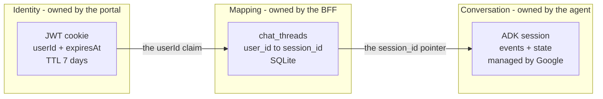
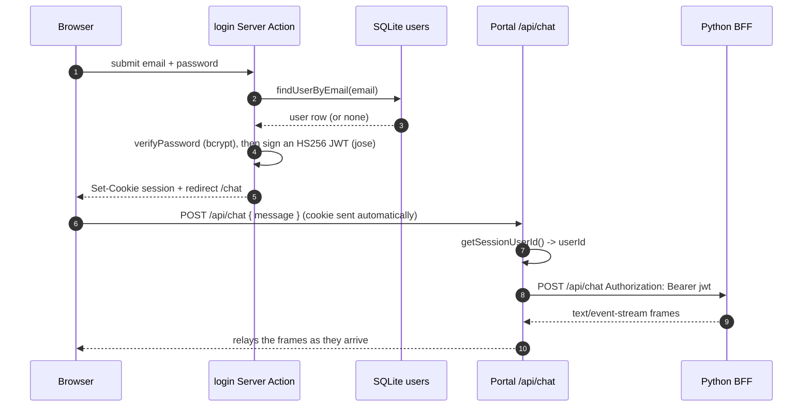

# 1. Architecture and the portal overview

This page gives you the shape of the whole system in a page or two, then a
concise overview of the portal — just enough to understand what the BFF consumes
(an identity) and what it produces (an agent conversation). The BFF itself is
the subject of [`02-bff-deep-dive.md`](./02-bff-deep-dive.md).

---

## The one idea the whole design hangs on

> **A login session is not an agent session.**

The portal's session is a JWT cookie that proves *who* the user is. The agent's
session is a *conversation thread* addressed by `(app_name, user_id, session_id)`.
Google's ADK never reads the cookie and cannot see the login. Someone has to
decide "does this user already have a conversation, or do we start a new one?" —
and hold a stable identity to key it on.

That someone is the BFF. It is the only component that knows both sides, so it
owns the mapping between them and the authorization that goes with it.

There are three stores of "state", each with a different lifetime. The core of
the design is that they are separate and joined only by two arrows:

**Reading this diagram.** Three boxes, one per store, left to right in
increasing lifetime. The arrows are the *only* links between them: the cookie's
`userId` becomes the mapping's key, and the mapping's `session_id` becomes the
agent's handle. Because the middle link is a stored row rather than something the
agent remembers, a user can log out and back in — a brand-new cookie — and still
resume the same conversation. That is the whole point of the BFF.

---

## The three tiers

| Tier | Repo | Tech | Owns | State |
|---|---|---|---|---|
| Portal | `akapal-geap-chat-portal` | Next.js 16 (App Router), React 19, Tailwind v4, TypeScript | Login, session cookie, chat UI, the `/api/chat` seam | `data/app.db` (`users`) |
| BFF | `akapal-geap-bff-python` | FastAPI, Agent Engine SDK (`agentplatform`) | `user_id -> session_id` mapping, ownership authorization, agent calls | `data/bff.db` (`chat_threads`) |
| Agent | deployed from `akapal-geap-agent` | Google ADK 2.6.2 (`AdkApp`) on Agent Runtime | Conversation history, memory, state, model calls | Agent Engine sessions |

The BFF is the pivot: it is the only tier that talks to *both* the portal's
identity and the agent's conversation. The portal never contacts the agent, and
the agent never learns about logins.

---

## Portal overview (concise)

The portal is a Next.js app that owns identity and the chat UI. It is described
in full in [`AUTH.md`](./AUTH.md) and [`../ARCHITECTURE.md`](../ARCHITECTURE.md);
here is only what the BFF needs to know about it.

**The path a turn takes.** A user signs in, gets an httpOnly JWT cookie, and from
then on every request carries it. The chat page calls the portal's own
`/api/chat` route, which plays the identity and forwards the turn to the BFF with
the cookie's JWT in an `Authorization: Bearer` header.

**Reading this diagram.** Time flows top to bottom; each column is a participant.
The first half is login: credentials never leave the server, and the output is a
signed cookie. The second half is a chat turn: the browser sends the cookie
automatically, the portal reads the cookie to recover `userId` (step 8), and only
then does it call the BFF. Note that the portal does **not** interpret the BFF's
reply — it relays the event-stream frames as-is. That is what makes the portal's
`/api/chat` a *seam* rather than a service: it forwards, it does not compute.

**Who is who in the portal.**

| Concern | File |
|---|---|
| Password hashing (bcryptjs, 10 rounds) | `src/lib/password.ts` |
| User store (Node `node:sqlite`) | `src/lib/db.ts` |
| Session cookie (jose, HS256, 7-day TTL) | `src/lib/session.ts` |
| Authoritative auth checks (`getSessionUserId`, `getCurrentUser`) | `src/lib/dal.ts` |
| Optimistic cookie-only route guard | `src/proxy.ts` |
| Login / logout Server Actions | `src/app/actions/auth.ts` |
| The BFF seam (`POST /api/chat`) | `src/app/api/chat/route.ts` |
| Chat UI (client component) | `src/app/chat/chat-window.tsx` |

Two details matter to the BFF:

- **Identity is `session.userId`**, a stable opaque id — never the email. This is
  the value the portal forwards as the JWT's `userId` claim, and the value the
  BFF reads back out. See [`../ADK_SESSION_AND_BFF.md`](../ADK_SESSION_AND_BFF.md)
  §5.5 on why it should be an internal id and never PII like an email.
- **The portal signs the cookie with `SESSION_SECRET`** (`src/lib/session.ts`).
  The BFF shares that exact secret, which is the entire trust relationship
  between the two.

---

## Where the BFF fits

The BFF is a small FastAPI service whose reason to exist is one decision and one
map:

- **The map:** `user_id -> session_id`, persisted in SQLite.
- **The decision:** for each turn, *create* a new agent session or *resume* an
  existing one — and if the client named a session explicitly, prove the user
  owns it first.

Around that sit a JWT verifier (northbound) and an Agent Engine client
(southbound). Everything else in the codebase supports those four things. The
full walkthrough is in [`02-bff-deep-dive.md`](./02-bff-deep-dive.md).

---

## The agent, as the BFF sees it

The BFF treats the agent as a remote service. Concretely, it is the
`akapal-geap-agents` Reasoning Engine on Agent Runtime:

- project `adk-tut-508714`
- region `us-central1`
- engine id `335803495506509824`

It is an `AdkApp` — an ADK agent the platform serves directly, so there is no
FastAPI app or Dockerfile inside the agent repo to own. The BFF drives it through
two operations, via the Agent Engine SDK rather than raw REST:

- `async_create_session(user_id=...)` — start a thread; returns its `id`.
- `async_stream_query(user_id=..., session_id=..., message=...)` — run one turn;
  returns a stream of events the BFF turns into reply text.

Those two calls, and the events they yield, are covered in
[`02-bff-deep-dive.md`](./02-bff-deep-dive.md) (`app/agent.py`, `app/events.py`)
and in [`04-contracts.md`](./04-contracts.md).
