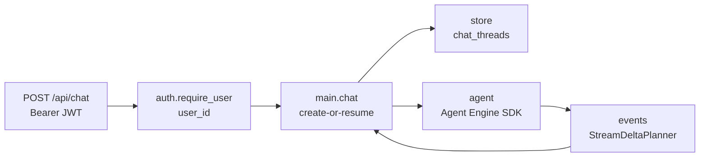
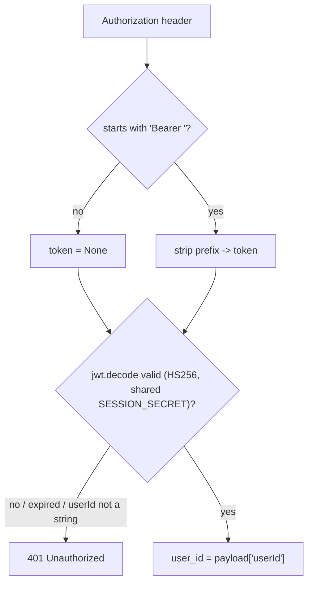
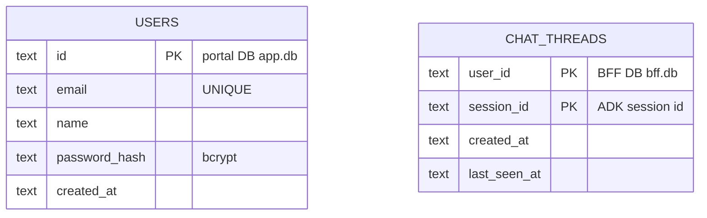
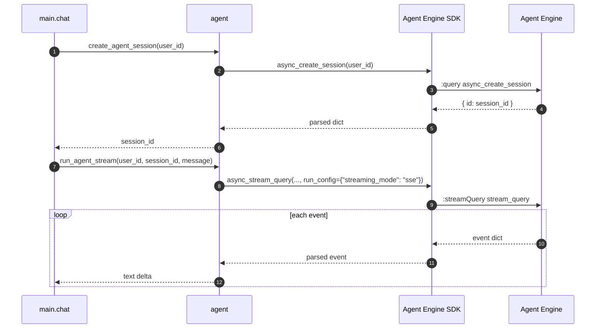
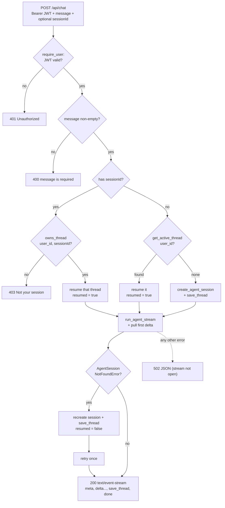

# 2. Python BFF deep dive

This is the main document. It walks the `akapal-geap-bff-python` service module
by module at the code level: what each file does, why it is shaped that way, and
where the interesting decisions live.

Read [`01-architecture.md`](./01-architecture.md) first if you do not yet have the
three-tier picture. The design rationale for the whole "login session is not an
agent session" idea is in [`../ADK_SESSION_AND_BFF.md`](../ADK_SESSION_AND_BFF.md).

---

## Why a BFF at all

Everything in this service exists to support one decision and one map. The split
of responsibility is:

| Concern | Owner | Where |
|---|---|---|
| Login, issuing the JWT cookie | Portal | `chat-portal/server.js` |
| Verifying that JWT and recovering `user_id` | **BFF** | `app/auth.py` |
| Mapping `user_id -> session_id`, persisted | **BFF** | `app/store.py` |
| Authorization: does this user own this thread? | **BFF** | `app/store.py` + `app/main.py` |
| Creating / resuming the agent session, running a turn | **BFF** | `app/agent.py` |
| Conversation history, state, memory | Agent | Agent Engine (Google) |

The mental model: **the BFF owns "who"; the agent owns "what was said."**

---

## Module map

| File | Responsibility |
|---|---|
| `app/config.py` | Environment-driven settings; derives the engine resource name |
| `app/auth.py` | Northbound boundary: verify the portal JWT, expose `require_user` |
| `app/store.py` | Southbound mapping: the `chat_threads` table and its three queries |
| `app/agent.py` | The SDK seam: create a session, stream a turn, classify errors |
| `app/events.py` | Turn the agent's event stream into progressive text deltas |
| `app/main.py` | The HTTP surface, the create-or-resume algorithm, and the SSE response |
| `tests/test_logic.py` | Network-free checks for `events.py` and `store.py` |

The request path through those modules:



**Reading this diagram.** Left to right is the order the code runs. `auth` gates
the request and yields a `user_id`; `main.chat` is the orchestrator that consults
`store` (the mapping) and `agent` (the remote); `events` is a pure helper `agent`
calls to turn raw events into progressive text deltas. Note that `main` is the
only module that imports the other three — the boxes below it do not know about
each other.

---

## `app/config.py` — configuration

Settings come from the environment (and a local `.env`, via `load_dotenv()` at
import). Every value has a default, so the service boots with nothing set — but
it warns loudly when `SESSION_SECRET` is missing, because without it no portal
token can ever verify.

```python
PORT = int(_env("PORT", "4000"))
SESSION_SECRET = _env("SESSION_SECRET", "")
DATABASE_PATH = _env("DATABASE_PATH", str(Path.cwd() / "data" / "bff.db"))

ENGINE_PROJECT = _env("GEAP_ENGINE_PROJECT", "adk-tut-508714")
ENGINE_LOCATION = _env("GEAP_ENGINE_LOCATION", "us-central1")
ENGINE_ID = _env("GEAP_ENGINE_ID", "335803495506509824")
ENGINE_RESOURCE = (
    f"projects/{ENGINE_PROJECT}/locations/{ENGINE_LOCATION}"
    f"/reasoningEngines/{ENGINE_ID}"
)
```

The important derived value is `ENGINE_RESOURCE`: the three separate engine
settings are assembled into the single fully-qualified resource name the SDK
needs — `projects/<project>/locations/<location>/reasoningEngines/<id>`. Building
it once here means `app/agent.py` never has to know how it is composed.

Full environment reference: [`04-contracts.md`](./04-contracts.md).

---

## `app/auth.py` — the northbound boundary

This is where the BFF consumes the portal's identity. It does not implement
login; it verifies the portal's already-signed JWT and reads `userId` out of it.

```python
def verify_portal_token(token: str | None) -> str | None:
    if not token:
        return None
    try:
        payload = jwt.decode(token, SESSION_SECRET, algorithms=["HS256"])
    except jwt.PyJWTError:
        return None
    user_id = payload.get("userId")
    return user_id if isinstance(user_id, str) else None
```

Three things to notice:

1. **Shared secret, symmetric algorithm.** The portal signs with `SESSION_SECRET`
   via `jose` HS256 (`server.js`); the BFF verifies with the *same*
   secret via PyJWT. This one shared value is the entire trust relationship.
2. **It only trusts a `userId` of type `str`.** Anything else (missing, wrong
   type, expired, bad signature) collapses to `None` — and therefore to a 401.
3. **Expiry is checked for you.** PyJWT validates the `exp` claim during
   `decode`, so an expired cookie fails exactly like a tampered one.

The FastAPI dependency wraps that into something a route can depend on:

```python
async def require_user(authorization: str | None = Header(default=None)) -> str:
    user_id = verify_portal_token(bearer_token(authorization))
    if not user_id:
        raise HTTPException(status_code=401, detail="Unauthorized")
    return user_id
```

`bearer_token` just strips the `"Bearer "` prefix. Any route that lists
`user_id: str = Depends(require_user)` either gets a verified, non-empty
`user_id` or the request never reaches the handler body.



**Reading this diagram.** Two gates in sequence: first the header has to be a
bearer token, then the token has to decode. Every failure mode funnels into the
single `401` terminal, which is deliberate — the client should not learn *why*
its token was rejected. The success path is the only way a `user_id` reaches
`main.chat`.

---

## `app/store.py` — the mapping

This file *is* the reason the BFF exists: the persistent `user_id -> session_id`
map. It is plain stdlib `sqlite3`, one table, three queries.

The schema:

```
CREATE TABLE IF NOT EXISTS chat_threads (
  user_id       TEXT NOT NULL,
  session_id    TEXT NOT NULL,
  created_at    TEXT NOT NULL,
  last_seen_at  TEXT NOT NULL,
  PRIMARY KEY (user_id, session_id)
);
```

The composite primary key `(user_id, session_id)` is what makes a thread unique
per user and lets the upsert work. There is no "is_active" flag: the *active*
thread is simply the row with the newest `last_seen_at` for that user.



**Reading this diagram.** An `erDiagram` lists tables as boxes and their columns,
with `PK` marking primary keys. The two boxes deliberately live in **different
databases** (annotated in the descriptions) and there is **no foreign key
between them** — the only link is the convention that `CHAT_THREADS.user_id`
equals `USERS.id`. The composite `(user_id, session_id)` key means one user can
hold many threads, while a given thread belongs to exactly one user.

The three functions:

```python
def get_active_thread(user_id: str) -> str | None:      # newest last_seen_at
def owns_thread(user_id: str, session_id: str) -> bool  # the ownership check
def save_thread(user_id: str, session_id: str) -> None  # upsert
```

- **`get_active_thread`** — `ORDER BY last_seen_at DESC LIMIT 1`. This is the
  "resume the user's current conversation" query used when the client does not
  name a thread.
- **`owns_thread`** — `SELECT 1 ... WHERE user_id = ? AND session_id = ?`. This
  is the security-critical query: it is the *only* thing standing between user A
  and user B's conversation. Removing it would let anyone read any thread by
  guessing an id.
- **`save_thread`** — an `INSERT ... ON CONFLICT(user_id, session_id) DO UPDATE
  SET last_seen_at = excluded.last_seen_at`. Called both when a thread is first
  created and after every turn, so `last_seen_at` doubles as "most recently used"
  and the call is safely idempotent.

A deliberate simplification lives here (see the end of this doc): `_connect()`
opens a fresh SQLite connection per operation and relies on `with` to commit.
That is fine for a single-process local service and keeps the file tiny.

---

## `app/agent.py` — the southbound seam

This is where the BFF talks to the deployed agent. It uses the Agent Engine SDK
(`agentplatform`), so there is no REST plumbing and no event parser here: the SDK
returns parsed event dicts.

```python
def _get_remote():
    global _remote
    if _remote is None:
        agentplatform.init(project=ENGINE_PROJECT, location=ENGINE_LOCATION)
        _remote = agent_engines.get(ENGINE_RESOURCE)
    return _remote
```

The remote handle is built lazily and cached in a module global, so the expensive
part (client init, resolving the engine) happens once per process rather than per
request.

Two operations are exposed:

```python
async def create_agent_session(user_id: str) -> str:
    session = await _get_remote().async_create_session(user_id=user_id)
    session_id = session.get("id") if isinstance(session, dict) else None
    if not session_id:
        raise RuntimeError(f"Agent did not return a session id: {session!r}")
    return session_id

async def run_agent_stream(user_id, session_id, message):
    planner = StreamDeltaPlanner()
    try:
        events = _get_remote().async_stream_query(
            user_id=user_id,
            session_id=session_id,
            message=message,
            run_config={"streaming_mode": "sse"},
        )
        async for event in events:
            for delta in planner.process(event):
                yield delta
    except Exception as exc:
        if _looks_like_missing_session(exc):
            raise AgentSessionNotFoundError(str(exc)) from exc
        raise
```

- **`create_agent_session`** calls the engine's `async_create_session` and pulls
  the new thread's `id` out of the returned dict. A missing id is a hard error —
  the BFF cannot do anything useful without a session id.
- **`run_agent_stream`** is an async generator: it yields reply text as each
  event arrives instead of buffering the turn. The `run_config` is load-bearing —
  without `streaming_mode: "sse"` ADK defaults to `StreamingMode.NONE`, yields a
  single final event with no partial chunks, and nothing would stream.
- **Error classification** is the subtle part. A dead/evicted session surfaces as
  *some* exception whose message contains "session" and "not found"; the helper
  re-classifies it as `AgentSessionNotFoundError` so `main.py` can retry, and
  re-raises everything else unchanged. The error normally lands on the first
  iteration, before any delta is yielded, which is what makes the retry safe.

```python
def _looks_like_missing_session(exc: Exception) -> bool:
    message = str(exc).lower()
    return "session" in message and "not found" in message
```



**Reading this diagram.** Two calls, top to bottom. The first creates a thread
and returns only its id. The second runs a turn and *yields text deltas as they
arrive* — the `loop` block marks each event turning into a delta — rather than
returning one final string. Passing `run_config` with `streaming_mode: "sse"` is
what makes the engine emit those partial events at all. The key difference from
the TypeScript BFF: the SDK (steps 3-5) hands back already-parsed dicts, so
`agent.py` has no JSON parser to maintain. It is the `:query` / `:streamQuery`
operations underneath, but the BFF author never writes them.

---

## `app/events.py` — events to progressive deltas

This file decides which text to forward as each event arrives. It is one small
stateful class, `StreamDeltaPlanner`, mirroring the reference planner in
`akapal-geap-ui/server.js`.

```python
class StreamDeltaPlanner:
    def __init__(self):
        self._author = None
        self._sent_any = False

    def process(self, event):
        deltas = []
        if not isinstance(event, dict) or event.get("author") == "user":
            return deltas
        author = event.get("author")
        if author != self._author:
            if self._author is not None and self._sent_any:
                deltas.append("\n\n")
            self._author = author
            self._sent_any = False
        parts = (event.get("content") or {}).get("parts") or []
        text = "".join(... )          # parts -> their text, if str
        if not text:
            return deltas
        if event.get("partial") or not self._sent_any:
            deltas.append(text)
            self._sent_any = True
        return deltas
```

The rules, and why each exists:

- **Partial events are the streaming chunks** — forwarded as they arrive.
- **The final, non-partial event repeats the full settled text**, so it is
  forwarded *only* if nothing has streamed yet for that author. That covers a
  turn that never emitted partials (so the reply is never dropped) and, when
  partials *were* streamed, avoids printing the whole answer a second time.
- **`author == "user"` events are skipped.** The stream echoes the user's own
  message; it must not appear in the reply.
- **A blank line between different authors** reproduces the `"\n\n"` join the
  non-streaming assembler used, so multi-agent turns (supervisor → specialist)
  read the same.
- **Non-dict events and missing/non-`str` parts are skipped**, so a tool-call
  event or shape drift cannot crash the stream.

This is where the Python BFF is dramatically smaller than the TypeScript one: the
TS BFF has a hand-rolled incremental JSON parser (`src/agent/stream.ts`) because
it speaks REST and must split concatenated events out of a raw byte stream. The
SDK hands back parsed dicts, so this collapses to the class above.

---

## `app/main.py` — the HTTP surface and the algorithm

`main.py` wires the FastAPI app and contains the create-or-resume logic. It is
the only place that composes `auth`, `store` and `agent`.

**The surface.** Two endpoints and one error handler:

```python
@app.get("/health")
async def health() -> dict: return {"ok": True, "engine": ENGINE_ID}

@app.post("/api/chat")
async def chat(body: ChatRequest, user_id: str = Depends(require_user)): ...
```

The `HTTPException` handler is there for a compatibility reason:

```python
@app.exception_handler(HTTPException)
async def http_exception_handler(_request, exc):
    return JSONResponse(status_code=exc.status_code, content={"error": exc.detail})
```

The TypeScript BFF returns errors as `{"error": ...}`, and the portal client reads
`data.error`. FastAPI's default error body is `{"detail": ...}`, so this handler
rewrites it to keep the error shape identical from the portal's point of view.

A **successful** turn is not a JSON body at all — it is a `StreamingResponse` of
`text/event-stream` frames, so the reply renders as it is generated. The four
frame types are in [`04-contracts.md`](./04-contracts.md); in short:

- `{"type": "meta", "userId", "sessionId", "resumed"}` — sent first;
- `{"type": "delta", "text"}` — one per streamed chunk;
- `{"type": "done", "reply"}` — the assembled reply, closing the stream;
- `{"type": "error", "error"}` — if the turn fails *after* the stream is open.

**The algorithm.** In order:

1. **Validate the message.** `(body.message or "").strip()`; if empty, return
   `400 {"error": "message is required"}`.
2. **Resolve the thread.**
   - If the client sent a `sessionId`: check `owns_thread(user_id, sessionId)`
     first. Not owned → `403 {"error": "Not your session"}`. Owned → use it,
     `resumed = True`.
   - Otherwise: `get_active_thread(user_id)`; found → use it, `resumed = True`;
     none → leave `thread_id` as `None`.
3. **Create if there is no thread.** `create_agent_session(user_id)` then
   `save_thread(...)` to persist the mapping. A failure here is a `502` JSON
   response — the stream has not opened yet.
4. **Open the stream and pull the first delta**, wrapped in a narrow retry:
   - `run_agent_stream(...)`, then `await anext(...)` for the first chunk. This
     blocks until the first token, so the stale-session check happens before
     anything is sent.
   - If it raises `AgentSessionNotFoundError`, the session was evicted/expired:
     create a *fresh* session, re-persist it, set `resumed = False`, and retry
     **once**.
   - Any other exception propagates to the outer handler → `502` JSON.
5. **Stream the turn** as SSE: emit `meta`, then each delta (starting with the
   first chunk already pulled), then `done` with the assembled reply.
6. **Refresh `last_seen_at`** with another `save_thread(...)` before `done`.

Once the `meta` frame is out, the status is fixed at `200`, so a turn that fails
mid-stream surfaces as an `error` frame rather than a `502`.



**Reading this diagram.** A `flowchart TD` reads top-down as *control flow*:
diamonds are decisions, rectangles are actions, and each labeled edge is the
answer to the decision above it. Follow any path from the top and you get a
complete request lifecycle. Two edges carry the design: the loop from `STALE`
back up to a *new* session is the single self-heal retry (it deliberately creates
a fresh thread rather than resuming the dead one), and the dotted edge out of
`RUN` to `E502` is the non-retryable escape hatch — reachable only *before* the
stream opens, which is why it can still be a `502`. The `owns_thread` diamond is
the only guard between a request and someone else's conversation.

### The `resumed` flag

`resumed` reports which path ran and is otherwise cosmetic:

- `false` — the BFF created a new agent session this turn (first message, or the
  retry after a stale session).
- `true` — it reused an existing one (explicit `sessionId` or the active thread).

The chat UI surfaces it as `sessionId · new` or `sessionId · resumed`.

### Making the stream actually stream

There is one non-obvious detail in `event_stream`, and without it the whole reply
arrives in a single burst at the end even though the BFF emits many `delta`
frames:

```python
await _yield_to_loop()   # == await asyncio.sleep(0), after every frame
```

The Agent Engine SDK **blocks the running event loop** while it awaits each
streamed chunk. Starlette writes a chunk with `await send(...)`, but the loop is
almost immediately re-entered — and then blocked — by the SDK's next read, so
uvicorn never gets a turn to flush the socket. Handing the loop one turn after
each frame lets the pending write flush before the next blocking read. (The
robust alternative is to run the SDK iteration on a worker thread; the loop-yield
is the minimal fix that keeps the code on one loop.)

---

## Failure modes

| Situation | Status / behaviour | Cause |
|---|---|---|
| Missing/invalid/expired JWT | `401 {"error": "Unauthorized"}` | `require_user` / `verify_portal_token` |
| Empty or whitespace message | `400 {"error": "message is required"}` | message validation in `chat` |
| Client sends a `sessionId` it does not own | `403 {"error": "Not your session"}` | `owns_thread` returns false |
| Agent session evicted/expired | Recreate once, `resumed=false`, retry | `AgentSessionNotFoundError` |
| ADC missing / no engine access (before the stream opens) | `502 {"error": <detail>}` | `agentplatform.init` or the SDK raises on the first chunk |
| Any other agent error before the stream opens | `502 {"error": <detail>}` | outer `except` in `chat` |
| Any agent error once the stream is open | `{"type": "error", "error"}` frame | the `event_stream` generator |

> Note: the `502` body currently carries the raw upstream error string, which can
> leak project/engine ids and IAM detail to the browser. Logging it server-side
> and returning a generic message is a known follow-up (see
> `../SESSION_HANDOFF_2026-10-08.md` §7.3).

---

## Tests

`tests/test_logic.py` is a stdlib `unittest` suite with no network and no SDK,
covering the two pure-ish modules. It points `DATABASE_PATH` at a throwaway temp
DB before importing `store`.

- **`StreamDeltaPlanner`** — forwards partial chunks and suppresses the final
  repeat; still emits text for a turn that never streamed; inserts a blank line
  between different authors; ignores non-dicts and events with no parts.
- **`store`** — `owns_thread` true for the owner and false for others;
  `get_active_thread` returns the saved thread or `None`; `save_thread` is
  idempotent.

Run them with:

```bash
python -m unittest discover -s tests
```

The suite does not touch the agent, so it runs without credentials. Verifying the
real end-to-end path (portal -> BFF -> agent) needs ADC with access to
`adk-tut-508714`.

---

## Deliberate simplifications

These are conscious trade-offs, each with an obvious upgrade path:

| Simplification | Where | Upgrade path |
|---|---|---|
| One SQLite connection per operation | `store._connect` | A long-lived connection or a pool if the DB grows |
| Deltas only, no tool/widget events surfaced | `agent.run_agent_stream` | Forward function-call parts if the UI grows widgets |
| "Missing session" detected by string match | `agent._looks_like_missing_session` | Use a structured error code from the SDK if one becomes available |
| Active thread = newest `last_seen_at`, no titles | `store.get_active_thread` | Add a `title` column and a thread-list endpoint for a sidebar |
| Retry exactly once | `main.chat` | Back off and cap retries if engines become flaky |
| No session TTL / cleanup | everywhere | A scheduled `delete` job, or the platform's TTL if sessions move to Vertex |

Each of these keeps the service small on purpose. Together they are why the Python
BFF is a fraction of the size of the hand-rolled REST version while exposing an
identical contract.
