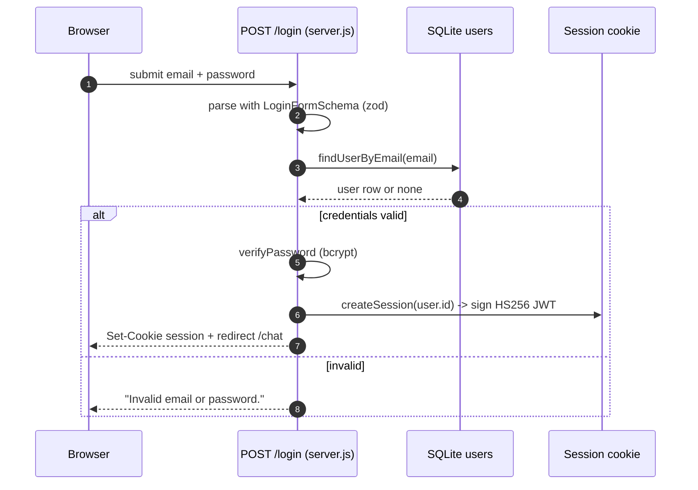
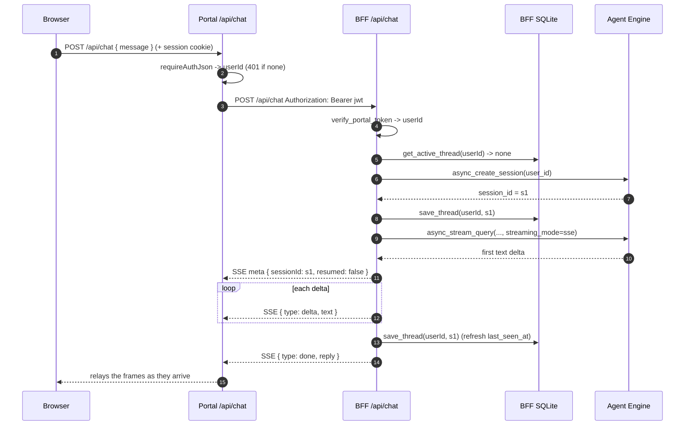
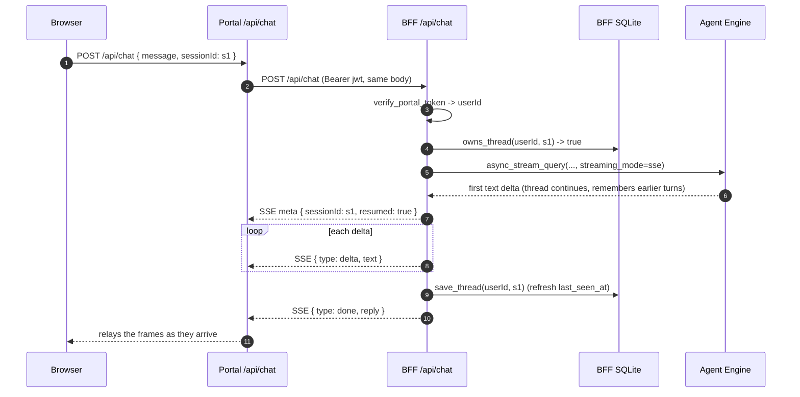
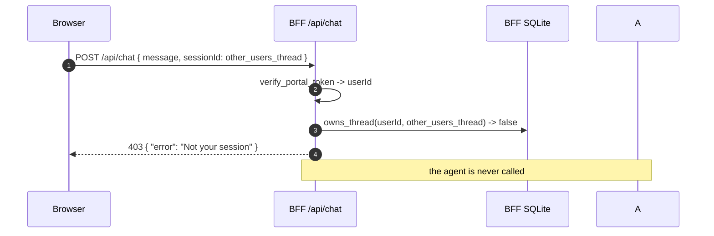
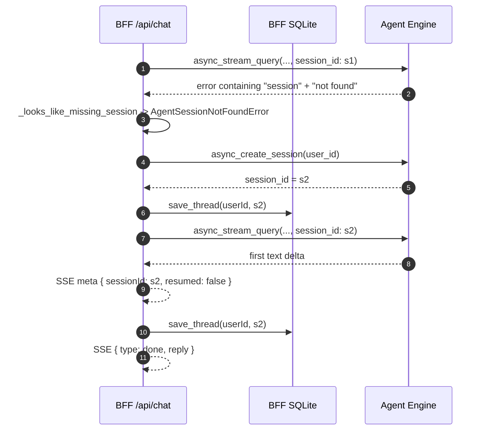
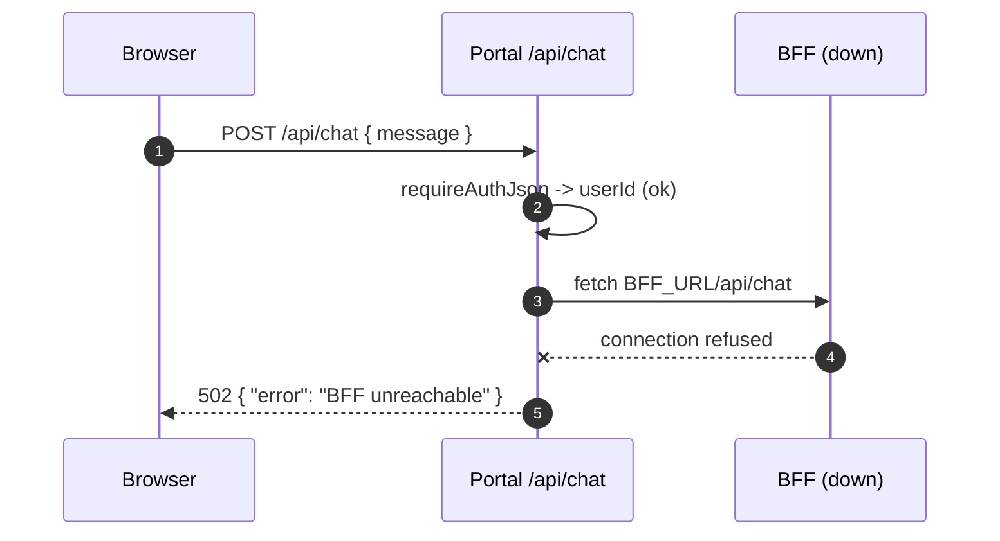

# 3. End-to-end flows

Sequence diagrams for the paths that matter, each followed by a note explaining
what to look at. The BFF's internal algorithm is in
[`02-bff-deep-dive.md`](./02-bff-deep-dive.md); this page is about what crosses
the wire, turn by turn.

---

## 3.1 Login — establishing the identity

Login happens entirely in the portal. Its only relevance to the BFF is that the
cookie it sets is the token the BFF later verifies.

**Reading this diagram.** Time flows down. The `alt/else` block is a branch:
only one arm runs. The credentials are validated against the `users` row and
never leave the server, and the output of the happy path is a signed httpOnly
cookie whose payload is `{ userId, expiresAt }`. Everything downstream — including
the BFF — depends on that cookie and the `userId` inside it.

---

## 3.2 First turn — a new agent session

The user's first message. No thread exists yet, so the BFF creates one.

**Reading this diagram.** The BFF is the pivot: it is the only column that talks
to both the database and the agent. Because `get_active_thread` returned nothing,
the create arm runs — `async_create_session`, then `save_thread`, then the turn.
The reply now **streams**: the BFF pulls the first delta (which is how it also
detects a dead session before sending anything), emits the `meta` frame with
`resumed: false`, then relays each `delta` as it arrives and closes with `done`.
`resumed: false` reports that a new session was created. The portal appears twice
on purpose: once doing its own auth, once relaying the BFF's frames verbatim
(`{ type: delta }` frames go straight through to the browser).

---

## 3.3 Resumed turn — continuing the thread

The second and later messages. The client now holds a `sessionId` from the
previous reply and sends it back, which exercises the explicit-resume *and*
ownership paths.

**Reading this diagram.** Same skeleton as 3.2, but two differences carry all the
meaning. First, the client sends `sessionId: s1`, so the BFF takes the
explicit-resume path and runs `owns_thread` — the authorization check — instead
of looking up the active thread. Second, the agent is handed the *same*
`session_id`, so the thread continues and the model remembers earlier turns.
`resumed: true` reports which path ran. The portal is unchanged from 3.2:
identity in, frames out.

---

## 3.4 Ownership rejection — a thread that is not yours

If a client sends a `sessionId` belonging to another user, the BFF refuses before
touching the agent.

**Reading this diagram.** The check happens in `owns_thread` (step 3), before any
agent call — note there is no Agent Engine column at all, because the request
never gets that far. This is the security-critical path: ADK's `user_id` is a
label, not a guard, so if this check were removed a user could read another
user's conversation simply by passing its id. The `403` tells the client the
thread is not theirs without revealing whether it exists.

---

## 3.5 Stale-session recovery — self-healing a dead thread

An agent session can be evicted or expired between turns. When the next turn
fails with a "session not found" error, the BFF recreates once rather than
returning an error.

**Reading this diagram.** Steps 1-2 are the failure; step 3 is the
re-classification (a string match, see the deep dive); steps 4-5 create and
persist a *fresh* session, and step 6 retries the turn against it. The retry
happens exactly once — and because it happens while pulling the *first* delta,
before the stream opens, a second failure is still a clean `502` rather than a
half-sent reply. Because a new session was created, `resumed` flips back to
`false`. The user sees a normal reply; the dead thread is invisible to them.

---

## 3.6 BFF unreachable — failing at the seam

The portal is a thin forwarder, so if the BFF is down the failure is reported at
the portal layer.

**Reading this diagram.** The portal has already established the user's identity
(step 2 passes), so this is not an auth failure. The `x` on the arrow marks the
failed connection. The portal catches the `fetch` rejection and returns its own
`502 {"error": "BFF unreachable"}` — a distinct, portal-owned message, so you can
tell "BFF is down" apart from "BFF answered with an upstream error" (which
returns the BFF's own `502` body). The browser surfaces whichever `error` string
it received.

---

## Where each status comes from

| Status | Produced by | Trigger |
|---|---|---|
| `401` | portal, then BFF | no/invalid session cookie (portal) or invalid JWT (BFF) |
| `400` | portal, then BFF | missing/empty `message` |
| `403` | BFF | `sessionId` not owned by the caller |
| `502 BFF unreachable` | portal | the BFF could not be reached |
| `502 <detail>` | BFF | the agent call failed before the stream opened |
| `200` + `{type:"error"}` frame | BFF | the agent failed after the stream opened |
| `200` + streamed frames | BFF | the turn completed (`delta` frames, then `done`) |
