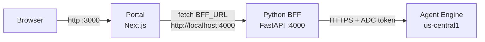
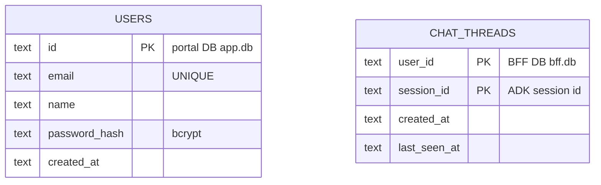

# 4. Contracts

The exact seam: the HTTP surface, the status codes, the environment variables,
the databases, and the agent operations the BFF drives. Everything here matches
the code as written in `akapal-geap-bff-python`.

---

## 4.1 HTTP surface

The Python BFF exposes two endpoints.

### `GET /health`

```json
{ "ok": true, "engine": "335803495506509824" }
```

Cheap liveness probe. `engine` is the configured engine id (`ENGINE_ID`), so it
also confirms which engine the service was pointed at.

### `POST /api/chat`

Request:

```
POST /api/chat
Authorization: Bearer <portal session JWT>
Content-Type: application/json

{ "message": "hello", "sessionId": "s-abc123" }
```

| Field | Required | Meaning |
|---|---|---|
| `message` | yes | The user's turn. Whitespace-only counts as empty. |
| `sessionId` | no | An existing thread to continue. Omit to continue the active thread. |

Response (`200`) is a `text/event-stream`, not JSON. Every frame is one
`data: <json>` line followed by a blank line:

```
data: {"type":"meta","userId":"…","sessionId":"…","resumed":true}
data: {"type":"delta","text":"Hel"}
data: {"type":"delta","text":"lo"}
data: {"type":"done","reply":"Hello"}
```

| Frame | Meaning |
|---|---|
| `meta` | Sent first. `userId` echoes the caller, `sessionId` is the thread to send back next turn, `resumed` reports which path ran |
| `delta` | One streamed chunk of the reply; append them in order |
| `done` | Closes the stream; `reply` is the assembled text |
| `error` | A failure that happened after the stream opened |

`resumed` is `false` when a new session was created: the first turn, or the retry
after a stale session (see [`03-flows.md`](./03-flows.md) §3.5).

### Status codes

| Status | Body | When |
|---|---|---|
| `200` | `text/event-stream` (frames above) | stream opened; the turn then streams |
| `400` | `{ "error": "message is required" }` | `message` empty or whitespace |
| `401` | `{ "error": "Unauthorized" }` | missing/invalid/expired bearer JWT |
| `403` | `{ "error": "Not your session" }` | `sessionId` not owned by the caller |
| `502` | `{ "error": "<upstream detail>" }` | agent/ADC failure *before* the stream opened |

Anything decided before the stream opens (400/401/403/502) is a JSON body,
exactly as before. Once the stream is open the status is already `200`, so a
turn that fails mid-stream ends with an `error` frame instead.

Error bodies are always `{"error": ...}`, not FastAPI's default `{"detail": ...}`,
because an exception handler rewrites them — see
[`02-bff-deep-dive.md`](./02-bff-deep-dive.md) (`app/main.py`). The portal relays
the stream verbatim and, for a non-streaming backend, normalises the old JSON
reply into these same frames — so the browser only ever sees one protocol.

---

## 4.2 Ports and coupling



**Reading this diagram.** The same system stripped to processes and ports. Two
Node/Python processes run locally: the portal on `:3000` and the BFF on `:4000`,
wired by the portal's `BFF_URL`. Only the BFF talks to Google. The browser never
contacts the BFF directly — every call goes through the portal's `/api/chat`,
which keeps the session cookie the single source of identity.

The two services are coupled by exactly **two** values:

- the shared **`SESSION_SECRET`** (so the BFF can verify the portal's JWT), and
- the portal's **`BFF_URL`** (how the portal reaches the BFF).

Everything else is independent — which is why the TS and Python BFFs are
drop-in swaps.

---

## 4.3 Environment variables

### BFF (`akapal-geap-bff-python`, from `app/config.py`)

| Var | Default | Purpose |
|---|---|---|
| `PORT` | `4000` | listen port |
| `SESSION_SECRET` | `""` (warns) | must equal the portal's; verifies the portal JWT |
| `DATABASE_PATH` | `./data/bff.db` | the `chat_threads` SQLite file |
| `GEAP_ENGINE_PROJECT` | `adk-tut-508714` | GCP project of the engine |
| `GEAP_ENGINE_LOCATION` | `us-central1` | region of the engine |
| `GEAP_ENGINE_ID` | `335803495506509824` | the Reasoning Engine id |

`GEAP_ENGINE_PROJECT` / `GEAP_ENGINE_LOCATION` / `GEAP_ENGINE_ID` are combined
into the single `ENGINE_RESOURCE` string the SDK is given. A `.env` file is
loaded at import, so local overrides go there.

### Portal (`akapal-geap-chat-portal`) — the values the BFF depends on

| Var | Default | Purpose |
|---|---|---|
| `SESSION_SECRET` | — (required) | HS256 key for the session JWT; **shared with the BFF** |
| `BFF_URL` | `http://localhost:4000` | where the portal forwards `/api/chat` |
| `DATABASE_PATH` | `./data/app.db` | the portal's `users` SQLite file |
| `COOKIE_SECURE` | `false` | `true` only behind HTTPS |

---

## 4.4 Databases

Three stores, one per tier. Only the first two are SQL; the third is Google's.

| Store | Owner | Table | Purpose |
|---|---|---|---|
| `data/app.db` | portal | `users(id, email, name, password_hash, created_at)` | credentials |
| `data/bff.db` | BFF | `chat_threads(user_id, session_id, created_at, last_seen_at)` | user -> session mapping |
| Agent Engine | Google | ADK sessions (`events`, `state`) | conversation content |

The BFF's table, verbatim:

```sql
CREATE TABLE IF NOT EXISTS chat_threads (
  user_id      TEXT NOT NULL,
  session_id   TEXT NOT NULL,
  created_at   TEXT NOT NULL,
  last_seen_at TEXT NOT NULL,
  PRIMARY KEY (user_id, session_id)
);
```



**Reading this diagram.** `PK` marks primary keys. The two tables live in
**different databases** and are joined by **no foreign key** — only by the
convention that `CHAT_THREADS.user_id` equals `USERS.id`. The composite
`(user_id, session_id)` key means a user can own many threads while a thread
belongs to one user, and it is what makes the `ON CONFLICT` upsert in
`save_thread` safe. Independent DBs are why identity and conversation can evolve
separately, and why the BFF carries no conversation content at all — just the
pointer.

---

## 4.5 Agent operations

The BFF calls the deployed `AdkApp` through the Agent Engine SDK
(`agentplatform`), not raw REST. Two operations:

| SDK call | Underlying engine operation | Returns |
|---|---|---|
| `async_create_session(user_id=...)` | `:query` with `async_create_session` | a session dict; the BFF reads `id` |
| `async_stream_query(user_id=..., session_id=..., message=..., run_config={"streaming_mode": "sse"})` | `:streamQuery` with `stream_query` | an async stream of event dicts (partial deltas plus a final aggregated event) |

The engine is addressed by `ENGINE_RESOURCE`
(`projects/<project>/locations/<location>/reasoningEngines/<id>`), built in
`app/config.py` and resolved once per process in `app/agent.py`.

### Event shape

An event yielded by `async_stream_query` looks roughly like:

```json
{
  "author": "user" | "<agent name>",
  "partial": true,
  "content": { "role": "…", "parts": [ { "text": "…" } ] }
}
```

`run_config` with `streaming_mode: "sse"` is required — without it ADK defaults
to `StreamingMode.NONE` and yields a single final event, so nothing streams.
`StreamDeltaPlanner` (`app/events.py`) forwards the `partial` chunks, suppresses
the final event's repeat once chunks have been sent, skips the echoed `user`
message, and joins different authors with a blank line. The full rules are in
[`02-bff-deep-dive.md`](./02-bff-deep-dive.md).

> This is the whole reason the Python BFF is smaller than the TypeScript one: the
> SDK yields **parsed dicts**, so there is no concatenated-JSON stream to split
> and no brace-depth parser to maintain. That parser exists only in the TS BFF,
> which speaks REST.
