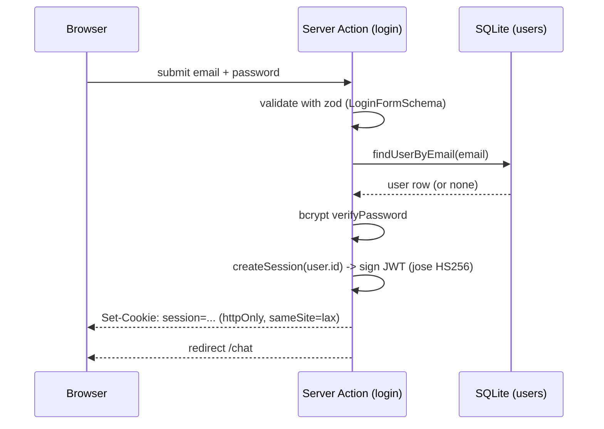
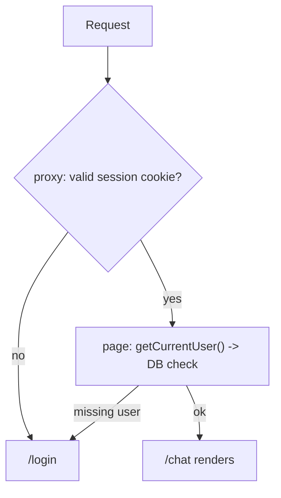

# Auth flow

Local credentials auth: email + password checked against a `users` row, then a
stateless JWT session in an httpOnly cookie. No external identity provider.

## Two layers of protection

1. **Optimistic — `src/proxy.ts`.** Runs before routes on `/chat*` and `/login`.
   Verifies the cookie with jose and redirects: unauthenticated `/chat*` → `/login`,
   authenticated `/login` → `/chat`. Cookie only, no DB access.
2. **Secure — `src/lib/dal.ts`.** The real check. Pages call `getCurrentUser()`;
   the route handler calls `getSessionUserId()` and returns `401` instead of
   redirecting.

## Identity

Identity is `session.userId` — a stable user id, never the email. This is the
value that becomes the ADK `user_id` in step 2 (see `ADK_SESSION_AND_BFF.md`).

| Concern | Where |
|---|---|
| Password hashing | `src/lib/password.ts` (bcryptjs, 10 rounds) |
| User store | `src/lib/db.ts` (node:sqlite) |
| Session cookie | `src/lib/session.ts` (jose, 7-day TTL) |
| Auth checks | `src/lib/dal.ts` |
| Login / logout actions | `src/app/actions/auth.ts` |
| Optimistic redirects | `src/proxy.ts` |
