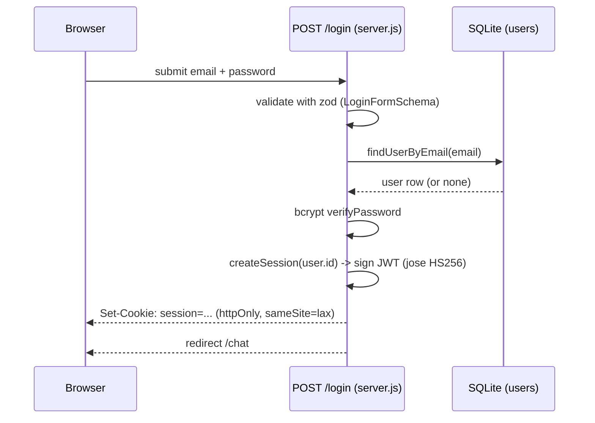
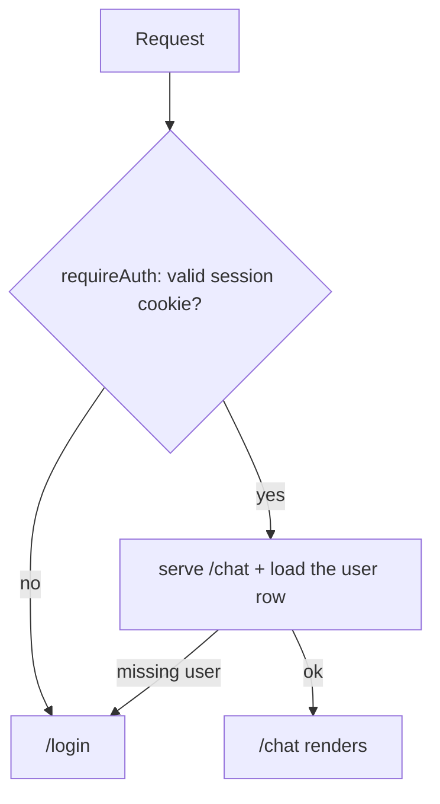

# Auth flow

Local credentials auth: email + password checked against a `users` row, then a
stateless JWT session in an httpOnly cookie. No external identity provider.

## Two layers of protection

1. **Guard — `requireAuth` / `redirectIfAuthed` in `server.js`.** Run on
   `GET /chat` and `GET /login`. Verify the cookie with jose and redirect:
   unauthenticated `/chat` → `/login`, authenticated `/login` → `/chat`. Cookie
   only, no DB access.
2. **API check — `requireAuthJson` in `server.js`.** The `/api/*` routes assert
   the same session and return `401` instead of redirecting.

## Identity

Identity is `session.userId` — a stable user id, never the email. This is the
value that becomes the ADK `user_id` in step 2 (see `ADK_SESSION_AND_BFF.md`).

| Concern | Where |
|---|---|
| Password hashing | `server.js` (bcryptjs, 10 rounds) |
| User store | `server.js` (node:sqlite) |
| Session cookie | `server.js` (jose, 7-day TTL) |
| Auth checks | `server.js` (`verifySession`, `requireAuth`, `requireAuthJson`) |
| Login / logout | `server.js` (`POST /login` / `GET /logout`) |
| Guards | `server.js` (`redirectIfAuthed`) |
